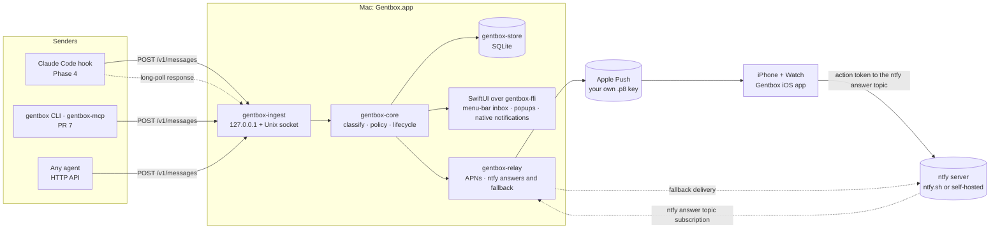
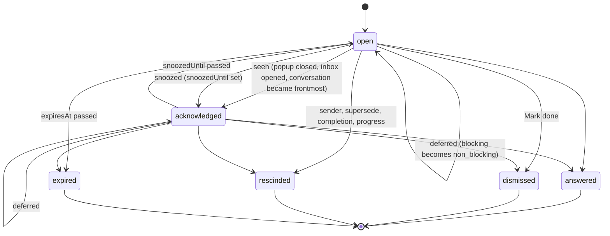
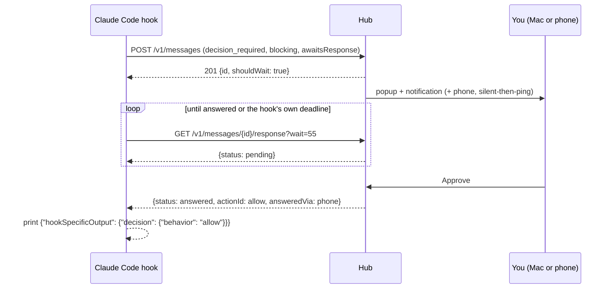

# Architecture

Gentbox receives messages from LLM agents, decides how loud each one should be, and delivers it to the Mac and the phone. The goal is a ping only for what needs you: a blocked session, a finished task when you are away, a question that can wait in an inbox. This document is the Phase 1 design. The decisions behind it are in [`adr/`](adr/), the wire format in [`schema/message-v1.json`](schema/message-v1.json), and the build order in [`implementation-plan.md`](implementation-plan.md).

Status tags: **Now** is built in Phase 3, **Planned** comes later, **Spike** must be verified before the PR that depends on it.

**Principle: no shared infrastructure, bring your own keys.** The project hosts nothing for its users: no server, relay, account system or asset host that other people would depend on. Each user brings their own credentials (an APNs key from their own Apple team, an ntfy topic or account, optionally a Pushover app token or a Tailscale network), entered in Settings and kept in the Keychain. Users may run infrastructure for themselves (a self-hosted ntfy server, a personal relay, an always-on box), and the design supports that where it helps, but no feature requires it: everything works with your Mac plus public services you pick (Apple's push service, ntfy.sh).

## 1. Message type, urgency and blocking

ADR: [0007](adr/0007-message-type-urgency-blocking.md). Three independent fields describe every message:

| Field | Values | Meaning |
| --- | --- | --- |
| `type` | `decision_required` | The agent needs your answer: approve or deny, pick a choice, reply (a permission prompt) |
| | `action_required` | You must do something yourself outside the conversation, then say Done (sign in, add a key, review a pull request) |
| | `task_completed` | Work finished; `scope: goal` marks the agent's overall objective |
| | `generic` | Everything else, kept for reference |
| `urgent` | `true`, `false` | Reach me now: Time Sensitive, breaks through quiet hours and Focus, "URGENT:" prefix |
| `blocking` | `non_blocking` | The agent keeps working and has planned for the answer to come later |
| | `deferrable` | The agent has paused; you may Defer to let it continue with work that needs no input |
| | `blocking` | Work cannot continue until you decide |

Defaults `generic`, `false`, `non_blocking`. `task_completed` and `generic` are always `non_blocking`, and `generic` is never urgent (§5.3).

The sender may declare any of the fields; deterministic rules fill the rest. No model is involved (§5.3).

A message also belongs to its **conversation** (one agent session, kept as metadata for Open, focus and coalescing) and to exactly one **thread** within exactly one **topic**. A topic is a project, a bigger undertaking, or a category for simple conversations; a thread is a version, a phase, or simply a conversation, and may span several conversations and agents. A message that names neither lands in its conversation's implicit thread under the agent's implicit General topic, so the inbox groups topic → thread → messages (§5.4, ADRs [0008](adr/0008-topics.md) and [0009](adr/0009-threads.md)). Gentbox topics are unrelated to ntfy topics, which the docs always call "ntfy topic".

## 2. System overview



## 3. Hub placement

ADR: [0001](adr/0001-hub-placement.md).

- **Mac (Now).** The Rust core runs in-process inside the SwiftUI menu-bar app, which registers itself as a login item (`SMAppService.mainApp`). One process owns the store, the ingest listener, the relay and the UI. The app talks to the core through UniFFI (`gentbox-ffi`), not over HTTP.
- **Headless (Now, Linux-first).** The same crates build the `gentboxd` binary: ingest, store, policy and relay without a UI. It serves Linux, a Mac without the app, and the integration tests. On Linux it runs as a systemd user unit (Planned: the unit file and desktop notifications over D-Bus).
- **One hub per user.** Each hub takes an exclusive lock on `<state>/hub.lock` before it binds anything. A second hub (the app while `gentboxd` runs, or two app builds) exits with "another hub is running (pid …)" instead of splitting state. The app does not become a client of a running daemon; on the Mac the app is the hub.

State folder, by signing:

| Signing | State folder |
| --- | --- |
| Paid team (the default from Phase 3 on) | `~/Library/Group Containers/group.com.eiluviann.gentbox` |
| Personal Team (App Group; ntfy fallback only) | `~/Library/Group Containers/<TEAM>.com.eiluviann.gentbox` |
| Ad hoc / unsigned / `gentboxd` on macOS | `~/Library/Application Support/Gentbox` |
| `gentboxd` on Linux | `$XDG_STATE_HOME/gentbox` (default `~/.local/state/gentbox`) |

The folder holds `hub.db`, `hub.lock`, `rules.toml`, `config.toml` and the `API/` discovery folder (§8). On Linux the two editable files, `config.toml` and `rules.toml`, live in `$XDG_CONFIG_HOME/gentbox` instead (default `~/.config/gentbox`), following the XDG split between configuration and state; on macOS everything stays in the one folder above.

## 4. Crates and processes

| Crate | Status | Responsibility | Depends on |
| --- | --- | --- | --- |
| `gentbox-core` | Now (PR 1) | Domain types (`Message`, `MessageType`, `Blocking`, `Source`, `Conversation`, `Action`, `LifecycleState`), classification, the policy engine, lifecycle transitions, action-token signing and verification (pure HMAC over bytes). Pure: no IO, no clock (time is passed in), no async | — |
| `gentbox-store` | Now (PR 2a) | SQLite through `rusqlite` (bundled), migrations, retention sweep, topics and threads, the single-use action-token ledger | `gentbox-core` |
| `gentbox-relay` | Now (PR 5) | `Relay` trait, `ntfy` adapter (publish, update, clear, the ntfy answer-topic subscription), payload modes, icon attachments. Knows nothing of the hub | `gentbox-core` |
| `gentbox-hub` | Now (PR 2b) | The hub actor that serialises every state change, timers, dispatch to channels (the UI delegate and a `dyn Relay`), action-token minting against the ledger | `gentbox-core`, `gentbox-store`, `gentbox-relay` (trait only) |
| `gentbox-ingest` | Now (PR 2b; optional remote routes for the iOS app in PR 8) | HTTP/1.1 (`axum` on `tokio`): the local router on loopback and the Unix socket, and the optional remote router on the Tailscale address; auth, schema validation, rate limits, long-poll. Routes only translate HTTP to hub commands | `gentbox-hub` |
| `gentboxd` | Now (PR 2b) | Binary: config, lock, logging, signal handling; wires hub, ingest and the configured relay | `gentbox-ingest`, `gentbox-hub`, `gentbox-relay` |
| `gentbox-ffi` | Now (PR 3) | UniFFI bindings for Swift. The only crate allowed `unsafe` (generated scaffolding); it has its own `[lints]` table | `gentbox-hub`, `gentbox-ingest`, `gentbox-relay` |
| `gentbox-node` | Planned | napi-rs bindings for the Linux Electron client | as `gentbox-ffi` |

The graph is acyclic: core ← store, relay ← hub ← ingest ← binaries and bindings.

**Concurrency.** A single hub actor (one `tokio` task in `gentbox-hub`) owns the in-memory view and is the only writer to the store. Ingest handlers, redeemed phone answers, the UI (through FFI) and the timers send it commands over an `mpsc` channel and await a reply. Long-polls wait on a per-message `tokio::sync::watch`. This makes "first answer wins" and supersede, rescind and defer races impossible by construction rather than by locking.

**Platform sensing stays on the platform side.** Presence (frontmost app, idle seconds, screen locked, Focus) is read by Swift on the Mac and pushed into the core as `PresenceUpdate` commands; the daemon on Linux will read logind's idle hint (Planned). The core never calls platform APIs, so the policy engine stays a pure function with table tests.

## 5. Message lifecycle and classification

### 5.1 Ingest pipeline

```
POST /v1/messages
  → authenticate (bearer token)             401
  → rate limit (per source.agent)           429 + Retry-After
  → size limit (128 KiB body)               413
  → validate against message-v1.json        422 with the failing JSON pointer
  → idempotency (source.agent, idempotencyKey)  200 with the stored message
  → classify, per field                     declared → user rules → built-in rules → defaults → normalize
  → resolve topic and thread                topic: named → rule → conversation's latest → General; thread: named → rule → conversation default (§5.4)
  → title guard                             commands, paths, URLs, raw input → body; descriptive title (§5.5)
  → coalesce / dedupe / supersede / rescind (§7)
  → persist
  → policy engine → DeliveryPlan            (§6)
  → dispatch to channels; answer 201
```

Response body of `POST /v1/messages`:

```json
{ "id": "01JBM3Z8Q7Y4K2N6P0R5T9VWXA", "type": "decision_required", "urgent": false, "blocking": "blocking", "fieldSources": { "type": "declared", "urgent": "default", "blocking": "declared" }, "topicId": "01JBM6R3K9P2W5X8Z1C4V7N0QD", "threadId": "01JBM9P3H4S5E6J7N8G9E0S1TQ", "state": "open", "shouldWait": true, "warnings": [] }
```

The full shape is `$defs/ingestResponse` in the schema; `warnings` reports what the hub changed, such as a title the guard rewrote (§5.5).

`id` is a ULID the hub assigns. It is the only message id in URLs and in `actionResponse.messageId`; the sender's `idempotencyKey` only deduplicates retries.

`shouldWait` tells a waiting sender whether long-polling is worthwhile. It is `false` when no channel can answer (every answer channel is muted, or the user is at the very app the agent runs in and the policy says not to interrupt there, §6.2), so a hook falls back to the agent's own prompt at once instead of holding it.

### 5.2 States



- `open`: delivered, needs attention; counts towards the menu-bar badge, may re-ping.
- `acknowledged`: you have seen it. No re-ping, no badge, still answerable. With `snoozedUntil` set it is hidden from the inbox's open list until then, and returns to `open` with one re-ping when the time passes.
- **Deferred** is not a state: Defer on a `deferrable` message records `deferredAt`, sets `blocking` to `non_blocking` and re-runs the policy (the popup closes, re-pings stop); the message stays open or acknowledged and still awaits the real answer.
- `answered`: an answer action was taken (`approve`, `deny`, `choice`, `reply`, `done`).
- `dismissed`: you chose "Mark done" without answering.
- `rescinded`, with a reason: `resolved_elsewhere`, `obsolete` or `superseded` (§7).
- `expired`: `expiresAt` passed while open or acknowledged.

Closing a popup or a notification only acknowledges.

**Answers and non-answers.** `approve`, `deny`, `choice`, `reply` and `done` are answers: the first one closes the message as `answered` and wakes the waiter. `defer` is an answer that does not close (above). `open` and `snooze` are non-answers: `open` acknowledges and brings the conversation forward, `snooze` acknowledges with `snoozedUntil = now + value` minutes (default 15). Neither is ever returned to a waiting sender.

**Live waiter.** A message has a live waiter while a long-poll for it is in flight or ended less than 10 s ago (the gap between two polls). `awaitsResponse` only declares the intent; it is the live waiter that counts everywhere below (answer buttons, supersede, implicit rescinds). A sender that stops waiting (deadline, error, fallback to its own prompt) rescinds its message with `DELETE /v1/messages/{id}` (`resolved_elsewhere`); if it dies without doing so, the waiter lapses after 10 s and the message becomes an ordinary item that completion or progress can rescind.

**What the long-poll returns** (`actionResponse.status`):

| Lifecycle | `status` |
| --- | --- |
| `open`, `acknowledged` (including snoozed) | `pending` |
| Defer just chosen | `deferred`, once; then `pending` again until the real answer |
| `answered` | `answered`, with `actionId`, `actionKind`, `value` |
| `dismissed` | `dismissed` |
| `rescinded` | `rescinded`, with `rescindReason` |
| `expired` | `expired` |

Default `expiresAt` when the sender gives none: `blocking` and `deferrable` 24 h, `non_blocking` decisions and actions 7 days, `task_completed` 7 days, `generic` 24 h. `generic` messages are born `acknowledged`: they never badge.

**Retention.** Answered, dismissed, rescinded and expired messages are deleted after 30 days. Since every message has a default expiry, nothing stays open forever unless a sender sets a far `expiresAt`. Configurable; the sweep runs at start and daily.

### 5.3 Classification

Each of `type`, `urgent` and `blocking` is resolved on its own:

1. **Declared** in the message: wins.
2. **User rules** from `rules.toml`, in file order: each matching rule sets only the fields still missing.
3. **Built-in rules** shipped with the app (the Claude Code mappings below), same way, so the hook stays thin and you can see and override them.
4. **Defaults:** `generic`, `false`, `non_blocking`.
5. **Normalize:** `task_completed` and `generic` become `non_blocking`; `generic` becomes not urgent. Declared invalid combinations never get here: the schema rejects them (422). Normalizations are recorded in the delivery log.

A user rule may set `override = true` to replace declared fields too: the escape hatch for a sender that over-declares.

```toml
# rules.toml — matched top to bottom; each rule fills the fields still missing.
[[rule]]
name = "Quiet the docs bot"
match = { source = "docs-bot" }
type = "generic"
override = true

[[rule]]
name = "Permission prompts at work are urgent"
match = { source = "claude-code", event = "claude-code.permission_request", cwd = "~/Work/**" }
urgent = true
override = true

[[rule]]
name = "Mute auth success"
match = { event = "claude-code.notification.auth_success" }
mute = true          # stored as generic, never shown outside the inbox history
```

Match keys (all optional, all must hold): `source` (exact), `event` (glob), `title` (regex), `cwd` (glob), `metadata.<key>` (exact). A rule sets any of `type`, `urgent`, `blocking`, `mute`, `topic` and `thread`, the last two as templates with `{project}` (working-directory name), `{agent}` and `{conversation}` placeholders, e.g. `topic = { key = "project:{project}", title = "{project}", kind = "project" }`; only for what the message did not name. Rules reload on file change; an invalid file keeps the last good rules and shows the parse error in Settings.

**Built-in Claude Code mapping** (the Phase 4 hook sends `event` and, where it is certain, the fields; `urgent` is false unless a user rule says otherwise):

| Hook event | `event` | `type` | `blocking` | Notes |
| --- | --- | --- | --- | --- |
| `PermissionRequest` | `claude-code.permission_request` | `decision_required` | `blocking` | Approve/deny/reply, `awaitsResponse`, `correlationKey = "permission:<agent_id or main>:<first 12 hex of SHA-256 of tool_name + tool_input>"` (the input has no `tool_use_id`), so parallel subagents' requests never supersede each other. Not `deferrable`: Claude Code cannot continue past a pending permission. Title built by the adapter, never from raw input: "Allow Bash to <description>?", "Allow editing <file name>?", "Allow fetching a page from <host>?", "Allow <Server> to <tool in words>?"; the command or input goes in the body (§5.5) |
| `Notification` `permission_prompt` | `claude-code.notification.permission_prompt` | `decision_required` | `blocking` | No waiter; folds into a live-waiter blocking item as a repeat (§7.3). Stands alone for sandbox network prompts, which have no `PermissionRequest` |
| `Notification` `elicitation_dialog` | `claude-code.notification.elicitation_dialog` | `decision_required` | `blocking` | Answer in the session; `open` action only |
| `Notification` `elicitation_url_dialog` | `claude-code.notification.elicitation_url_dialog` | `action_required` | `blocking` | You open a URL and act there |
| `Notification` `agent_needs_input` | `…agent_needs_input` | `decision_required` | `blocking` | |
| `Notification` `quota_auto_resume_stale` | `…quota_auto_resume_stale` | `action_required` | `blocking` | Press Enter in the session after a sleep |
| `Notification` `idle_prompt` | `claude-code.notification.idle_prompt` | `generic` | — | Fires 60 s after a response with no typing, after the `Stop` already notified you; a reminder, not a new ask. `correlationKey = "idle"`; rescinded by progress |
| `Notification` `agent_completed` | `…agent_completed` | `task_completed` | — | |
| `Notification` `auth_success`, `elicitation_complete`, `elicitation_response`, `quota_auto_resume_fired`, `quota_auto_resume_disabled`, `plugin_notification` | `…<type>` | `generic` | — | |
| `Stop`, `background_tasks` empty | `claude-code.stop` | `task_completed` | — | Title: the first sentence of `last_assistant_message`, summary: the next ones, both through the title guard; fallback "Claude Code finished a task in <project>" |
| `Stop`, `background_tasks` non-empty | `claude-code.stop.paused` | `generic` | — | The session waits on its own background work; not done yet |
| `StopFailure` | `claude-code.stop_failure` | `action_required` | `blocking` | The turn ended on an API error; retry in the session |
| `SubagentStop` | `claude-code.subagent_stop` | `generic` | — | |
| `SessionStart` | — | — | — | Registers or renames the conversation (`PUT /v1/conversations/{agent}/{id}`), sends no message |
| `UserPromptSubmit`, `PostToolUse`, `PostToolUseFailure` (all `async`) | — | — | — | `POST /v1/conversations/{agent}/{id}/progress`, sends no message (§7.6) |

The MCP `ask` tool (PR 7) declares the fields itself: `decision_required` by default, with `blocking` chosen by the agent, `deferrable` when it can continue with other work.

### 5.4 Topics and threads

ADRs: [0008](adr/0008-topics.md) (topics), [0009](adr/0009-threads.md) (threads, defaults).

- **Hierarchy:** topic → thread → messages. Every message is in exactly one thread, every thread in exactly one topic. The conversation stays metadata on each message. Threads and topics may span several conversations and agents.
- **Topic:** hub `id`, stable agent-chosen `key` (unique per hub, across agents), `title`, optional `summary`, a free-form `kind` hint (`project`, `category`, `other`, …), `style` (SF Symbol and colour hints, also used by its threads), `implicit`, `status`, `createdBy`, timestamps. The only implicit topic is each agent's **General** topic (`kind: "general"`, no key).
- **Thread:** hub `id`, `topicId`, optional `key` (unique within its topic), `title`, optional `summary`, a free-form `kind` hint (`version`, `phase`, `conversation`, `other`, …), `implicit`, `status`, `defaultFor`, `createdBy`, timestamps. `kind` never changes behaviour.
- **Resolution:** `thread: { "id": … }` fixes both (a conflicting `topic` is a 422). Otherwise the **topic** is the named one → a rule-assigned one → the topic of the conversation's latest default thread → the agent's General topic; then the **thread** within it is the named one (`{ "key": … }`, created on first use) → a rule-assigned one → the conversation's **default thread** in that topic: an implicit thread (`kind: "conversation"`, no key, titled and renamed with the conversation) created on first use.
- **Takeover:** an explicit thread created with `kind: "conversation"` and `conversation.id` takes over that conversation's implicit thread in its topic (messages and mute move in, the implicit thread goes, later default messages follow). Only the first; the inline `thread` form never takes over. Topics have no takeover.
- **API:** topics as in ADR 0008; threads with `POST /v1/threads` (upsert by key within the topic), `GET`, `PATCH`, close, reopen, rescind-all, `PUT /v1/threads/{id}/topic` (move a thread), and `PUT /v1/messages/{id}/thread` (move a message, `null` to re-resolve). Implicit topics and threads answer 409 to agent PATCHes.
- **Grouping only.** A message keeps its own `type`, `urgent` and `blocking`; coalescing and implicit rescinds stay per conversation (§7). The one delivery effect is mute (§6.2).
- **Close:** closing a topic closes its open threads (and reopening it reopens those); open messages stay unless `rescindOpenMessages: true`. A message to a closed thread reopens it and its topic.
- **For you:** mute, mark read, close and reopen at both levels (a muted topic mutes its threads); move a thread or a message.
- **Inbox:** topic → thread → messages; each message row shows its conversation. A simple conversation shows as General → its thread. Closed topics and threads move to a Closed section.

### 5.5 Titles are descriptive summaries

ADR: [0010](adr/0010-descriptive-titles.md).

- **Rule:** `title` and `summary` say in plain words what the agent asks or did ("Allow Bash to run the ingest tests?", "Ingest auth accepts rotated tokens; 12 tests pass"). Commands, paths, URLs and raw tool input go only in `body`, which surfaces show as code boxes. The same holds for conversation, topic and thread titles.
- **Enforced once, in the hub:** the **title guard** (a pure function in `gentbox-core`) flags text with code marks, shell operators, flags, paths, environment assignments, URLs, JSON, or a leading command name with arguments (the exact list is in ADR 0010).
- **On a flag** (default `rewrite` mode): the message title moves to the top of the body as "Original title" and is replaced by the summary's first sentence when that passes, else by a fallback phrase from the message's fields and project ("Claude Code needs your decision in gentbox"); a flagged summary moves to the body and is dropped; a flagged conversation title is ignored; explicit topic and thread creates answer 422, inline ones fall back to the key in words. The response's `warnings` says what changed, and the delivery log records it.
- **Strict mode** per source (`titleGuard = "reject"`) answers 422 `title_looks_like_command` instead: for adapters under development; never the default, because rejecting a blocking prompt strands the agent.
- **Up front:** the Claude Code adapter builds titles from the hook input (table in §5.3) and never copies `tool_input` into a line; the MCP tools state the rule and pass the hub's warnings back to the model.
- **Surfaces trust `title` and `summary` as-is** and never sanitise them.

## 6. Noise-policy engine

ADR: [0004](adr/0004-policy-engine.md).

### 6.1 Shape

```rust
fn decide(message: &Message, context: &PolicyContext, policy: &Policy) -> DeliveryPlan
```

- `PolicyContext`: presence (`away` = screen locked or idle ≥ `awayAfter`, frontmost bundle id), Focus on/off, quiet hours active, whether the message's topic or thread is muted, the conversation's open items, the clock.
- `Policy`: settings from `config.toml` keyed on `(type, urgent, blocking)`, defaults below.
- `DeliveryPlan`: `mac` (one of `persistent_popup`, `toast`, `banner`, `inbox_only`), `nativeNotification` (`none`, `active`, `time_sensitive`), `sound` (bool), `phone` (`now(level)`, `silentThenPing { level, after }`, `silent`, `none`), `reping` (`after`, `max`) and `offerDefer` (bool).

The three fields do separate jobs: **`type`** picks the surface and the title phrase, **`blocking`** drives persistence and escalation (popup, re-ping, Defer) and the blocking badge, **`urgent`** drives interruption (Time Sensitive, quiet hours and Focus breakthrough, the "URGENT:" prefix).

Timers (re-ping, phone escalation, snooze, expiry) are scheduled by the hub actor; when one fires the actor re-runs `decide` with the current context, so a message answered or rescinded in the meantime sends nothing. Every decision is stored in a `deliveries` table, which is what the inbox's "why did this ping me?" line reads.

### 6.2 Defaults

By blocking level (for `decision_required` and `action_required`) and type:

| | Mac | Phone |
| --- | --- | --- |
| `blocking` | Persistent rich popup until handled, native notification, sound. Re-ping every 5 min, at most 3 times, while `open` | Silent-then-ping |
| `deferrable` | Persistent rich popup with a Defer button, native notification, sound. Re-ping every 10 min, at most 2 times. After Defer: as `non_blocking` | Silent-then-ping; Defer is a phone button |
| `non_blocking` | Native banner and inbox, no re-ping | Silent-then-ping |
| `task_completed` | Transient rich toast (6 s); suppressed when the conversation's app is frontmost; auto-acknowledged when you bring the conversation forward | Silent-then-ping |
| `generic` | Inbox only, silent | Never |
| Any non-urgent message in a muted topic or thread | Inbox only, silent, no re-ping; `shouldWait: false` for its sender | Never |

`urgent` modifies every row above:

| | `urgent: false` | `urgent: true` |
| --- | --- | --- |
| Native notification (Mac, iPhone) | Active | Time Sensitive |
| Phone audible level | Active (ntfy fallback: priority 3) | Time Sensitive (ntfy fallback: priority 5) |
| Title | Type phrase | "URGENT: " + type phrase (the only thing that sets the prefix) |
| Quiet hours | Mac silent, toasts and banners inbox-only; phone silent, no escalation | Breaks through: shown, audible, escalates |
| Focus (Mac popups and toasts) | Popups silent, toasts inbox-only | Shown and audible |

**Silent-then-ping** (the user's rule, 2026-10-23):

- **Mac in active use** (unlocked, input within `awayAfter`, default 5 min): the phone gets the notification at once but silently (APNs `interruption-level: passive`; ntfy fallback: priority 2; either way it lands in Notification Centre with no sound and no screen wake). If the message is still not addressed on any device 2 min later, it is sent again under the same collapse id at its audible level and pings (ADR 0006). On the ntfy fallback, which cannot update a delivered notification, the escalation is a second notification (ADR 0007).
- **Mac away** (locked, or idle ≥ `awayAfter`): the phone pings at once at the audible level.
- **Addressed** means acknowledged, answered, deferred, dismissed or rescinded anywhere: on the Mac, the phone or in the session, the popup or notification closed, the conversation brought forward, or the message opened in the inbox.
- **Noise guard.** Escalations that fall within 60 s of each other share one sound; the rest update silently.

Every cell is configurable per `(type, urgent, blocking)` (and per source, Planned). With this rule a completion you ignore at the Mac also pings the phone after 2 min; turn the phone off for `task_completed` if that is too much.

### 6.3 Quiet hours and Focus

- **Quiet hours** (a weekly schedule, default off): non-urgent messages stay silent on the Mac and the phone and do not escalate; urgent ones break through (table above).
- **Focus.** macOS filters our native notifications by the active Focus; urgent ones are Time Sensitive and break through unless you turn that off for the app. Our own popups and toasts are not subject to Focus, so the engine applies the same rule to them: non-urgent popups appear silently and toasts become inbox-only; urgent ones are shown and audible.
- **How the hub learns Focus** (Spike S3, §11). `INFocusStatusCenter`, which the paid team's Communication Notifications capability allows: the app asks once for Focus status access and polls `isFocused` on presence changes (key-value observation is reported not to work [Apple-forum-682143]). `isFocused` is true only when a Focus is on and Gentbox is not on its allowed list, which is exactly when the engine should hold back. Fallbacks, for builds without the paid team: read `~/Library/DoNotDisturb/DB/` behind Full Disk Access, or a Shortcuts automation running `gentbox focus on|off`.

### 6.4 Frontmost suppression

A `task_completed` toast is suppressed when `conversation.focus.bundleId` equals the frontmost app's bundle id. This is per app, not per tab: with two Claude Code sessions in one Ghostty window, finishing the background one is suppressed too. Tab-level matching (tty of the frontmost terminal tab) is Planned and needs Apple Events per terminal.

## 7. Coalescing, dedupe, supersede, rescind

All within one conversation (`source.agent` + `conversation.id`). Rules are applied in this order by the hub actor, one message at a time, so none of them can interleave with an answer.

1. **Idempotency.** Same `source.agent` + `idempotencyKey` → return the stored message, change nothing.
2. **Supersede (implicit rescind).** A message whose `correlationKey` matches an `open` or `acknowledged` message takes its slot: the old one is rescinded as `superseded`, the new one takes over its popup and native notification in place (same notification identifier, same APNs collapse id). It does not re-ping unless it is louder (urgent, or a higher blocking level) than the old one. A live waiter of the old message gets `rescinded` / `superseded`.
3. **Fold.** A message with no live waiter never displaces one that has a live waiter: if its correlation key matches such a message, or it is a `blocking` or `deferrable` message while the conversation has such an item with a live waiter, it is not stored as a new item and only increases that item's repeat counter.
4. **Dedupe.** If the superseding message has the same fields, title and summary as the old one and arrives within 10 s, it is dropped and only a repeat counter increases.
5. **Completion rescinds what waited on it.** A `task_completed` message rescinds, as `obsolete`, the conversation's `open`/`acknowledged` `blocking` and `deferrable` messages that have no live waiter. A message with a live waiter stays open (the agent cannot have finished while it waits); `non_blocking` messages survive the end of the turn.
6. **Progress rescinds.** `POST /v1/conversations/{agent}/{id}/progress` (Claude Code: async `UserPromptSubmit`, `PostToolUse`, `PostToolUseFailure` hooks) rescinds, as `resolved_elsewhere`, the conversation's `idle` item and its `blocking` and `deferrable` items without a live waiter: something happened, so whatever they asked for was handled in the session. This covers a permission answered or denied in the terminal.
7. **Explicit rescind.** `DELETE /v1/messages/{id}`, `POST /v1/conversations/{agent}/{id}/rescind`, or the `rescinds` field on a new message, with a reason (ADR 0007). Effects in every channel: popup and toast removed; Mac native notification removed; inbox row kept and marked "Withdrawn" with the reason in words (superseded rows fold into their successor instead); the own iPhone app removes the delivered notification through a background push and `removeDeliveredNotifications`, falling back after 60 s to a passive "Withdrawn" replacement under the same collapse id; the ntfy fallback cannot remove or update a delivered notification, so the hub publishes a min-priority "Withdrawn" notice only when the original had pinged, and ignores taps on the stale buttons.
8. **Topics and threads never coalesce.** Two conversations in one thread keep separate slots, popups and rescinds; only the inbox and the lock screen group them (§5.4).
9. **Popup coalescing.** The Mac shows at most one persistent popup per conversation (its newest `blocking` or `deferrable` item) and stacks at most 3 conversations; more collapse into "+N waiting" which opens the inbox.

## 8. Ingest API and transport

ADR: [0002](adr/0002-ingest-transport.md).

**Listeners.**

- A Unix socket `<state>/API/hub.sock` (mode 0600, in a 0700 folder): the preferred transport for local clients, since only you can connect to it and nobody else can stand in for it.
- The same router on HTTP/1.1 `127.0.0.1:<port>` (random free port at start, never `0.0.0.0`) for clients that cannot use a socket.
- Remote listener for the own iOS app's full bodies, off by default and only with Tailscale (§10, optional PR 8).

**Discovery** (Vaultday's pattern, hardened). `<state>/API/` (0700) holds `hub.sock`, `token` (0600, 256-bit random, base64url) and `port`. The hub removes `port` on quit. Clients (CLI, MCP server, hook) search the App Group container, then `~/Library/Application Support/Gentbox/API`, then `$XDG_STATE_HOME/gentbox/API` (`GENTBOX_API_DIR` overrides), use the socket when it exists, and fall back to TCP only after the hub proves itself: `POST /v1/hello {"nonce": "<random>"}` is the one unauthenticated route and answers `HMAC-SHA256(token, nonce)`. The client sends its bearer token only after checking that proof, so a process of another user squatting on a port left behind by a crash learns nothing.

**Endpoints** (all but `hello` require `Authorization: Bearer <token>`, the sender token). `{id}` is always the hub-assigned message id.

| Method and path | Purpose |
| --- | --- |
| `POST /v1/hello` | Challenge-response proof (above); returns hub version and schema versions |
| `POST /v1/messages` | Ingest one message (§5.1) |
| `GET /v1/messages/{id}/response?wait=<s>` | Long-poll for the answer; holds up to `wait` seconds (max 55), returns `actionResponse` (`pending` on timeout) |
| `DELETE /v1/messages/{id}` | Rescind one message; body `{ "reason": … }`, default `resolved_elsewhere` (§7.7) |
| `POST /v1/conversations/{agent}/{id}/rescind` | Rescind by correlation keys; body `{ "reason": …, "correlationKeys": [ … ] }` |
| `PUT /v1/conversations/{agent}/{id}` | Register or rename a conversation (Claude Code `SessionStart`) |
| `POST /v1/conversations/{agent}/{id}/progress` | The conversation moved on (§7.6) |
| `POST /v1/presence/focus` | `{ "focused": true }` from the Shortcuts automation |
| `POST /v1/topics` | Create a topic, upsert by `key` (§5.4) |
| `GET /v1/topics?status=open` | List topics (no messages) |
| `GET /v1/topics/{id}` · `PATCH /v1/topics/{id}` | Read one; rename or edit it |
| `POST /v1/topics/{id}/close` · `/reopen` · `/rescind` | Close (and its open threads; optionally withdrawing open messages), reopen, or withdraw its open messages |
| `POST /v1/threads` | Create a thread, upsert by `key` within its topic (§5.4) |
| `GET /v1/threads?topic={id}&status=open` | List threads (no messages) |
| `GET /v1/threads/{id}` · `PATCH /v1/threads/{id}` | Read one; rename or edit it |
| `POST /v1/threads/{id}/close` · `/reopen` · `/rescind` | Close (optionally withdrawing its open messages), reopen, or withdraw its open messages |
| `PUT /v1/threads/{id}/topic` | Move a thread with its messages to another topic |
| `PUT /v1/messages/{id}/thread` | Move a message to another thread, or back to its default resolution with `null` |

**No answer route for senders.** The sender token can post, wait, rescind and report progress, but cannot answer or list messages (rescinding never answers): an agent that can read `API/token` must not be able to approve its own permission prompt or read other sessions' messages. Answers come only from the Mac UI (in-process, through FFI) and from the phone with per-action tokens (§9.3). A local "answer from the CLI" is Planned behind a separate answer credential kept in the Keychain with user presence (Touch ID), which an agent cannot read silently.

**`Host` check.** On TCP, `Host` must be `127.0.0.1:<port>` or `localhost:<port>`; on the Unix socket it is not checked (clients send `Host: localhost` or nothing).

**Rate limits.** Token bucket per `source.agent`: burst 30, refill 1/s; per-conversation burst 10. Over the limit → 429 with `Retry-After`. Body limit 128 KiB.

**Error codes.** 422 bodies carry a `code`: `schema_invalid` (with the JSON pointer), `invalid_combination`, `topic_conflict`, `title_looks_like_command` (strict mode, and explicit topic or thread creates).

**Versioning.** `/v1/` in the path and `"version": 1` in the body. Additive optional fields stay in v1; anything else is v2 on a new path, served alongside v1 for at least one release.

## 9. Action round-trip

### 9.1 Local



- **First answer wins.** The hub actor accepts the first answer and closes the message; later answers (the other device, a re-tap) get 409 and the UI shows "Already answered on <channel>".
- **Answer buttons need a live waiter** (§5.2). Without one, approve/deny/reply/choice are hidden (and disappear from an open popup when the waiter lapses) and only open, snooze and Mark done remain, so a button never pretends to do something.
- **The hook cleans up.** Whenever it stops waiting without an answer it calls `DELETE /v1/messages/{id}` (`resolved_elsewhere`) before printing nothing, so the popup closes as the agent's own prompt takes over.
- **Mapping for Claude Code `PermissionRequest`** (Phase 4): `approve` → `{"behavior": "allow"}`; `deny` → `{"behavior": "deny", "message": "Denied from Gentbox"}`; `reply` → `deny` with your text as `message`, which tells Claude what to do instead.
- **Timeouts.** Command hooks default to a 600 s timeout and are cancelled at it, output discarded; no maximum is documented [CC-hooks › Common fields, Timeouts]. The hook sets its own deadline below its configured `timeout` and exits with no output, which leaves the permission flow unchanged [CC-hooks › PermissionRequest decision control].
- **Fallback.** No answer by the deadline, `shouldWait: false`, hub unreachable, or any error → the hook prints nothing and Claude Code shows its own prompt. Gentbox never decides on its own.

### 9.2 Open

`open` brings the conversation forward, trying in order: `focus.url` (only schemes on the allowlist: `claude-cli`, `claude`, `vscode`, `cursor`, `https`), then the terminal tab (Planned: Apple Events to Terminal.app and iTerm2 by tty), then activating `focus.bundleId`. Claude Code has no URL that opens a specific session: `claude-cli://open` starts a new terminal session with `cwd`/`repo`/`q` [CC-deeplinks], and Claude Desktop documents only `claude://code/new` [CC-desktop › Open an SSH session from a link]. So a Desktop-hosted session is opened by activating `com.anthropic.claudefordesktop`, and a terminal session by activating its terminal app.

### 9.3 Phone

Two paths, both ending at the **ntfy answer topic** the hub subscribes to (outbound, no inbound port, no VPN):

- **Own iOS app (APNs, the default with the paid team).** Notification buttons (Approve, Deny, choices, Reply with text) run in the app's background handler, which posts the action token and the reply text to the ntfy answer topic and finishes. Approve requires an unlocked device (`.authenticationRequired`). Details in ADR 0006.
- **ntfy app (fallback).** `http` buttons post the action token to the ntfy answer topic themselves [ntfy-ios ActionExecutor.swift]. Up to 3 buttons, `view` and `http` only, no text reply, and the tap opens the ntfy app with no visible result [ntfy-ios Actions.swift, NotificationContent.swift:166].

Common to both:

- **Action tokens.** `base64url(payload) "." base64url(HMAC-SHA256(key, payload))`, payload = message id, action id, nonce, expiry. The key is 256-bit, per hub, in the Keychain (Mac) or a 0600 file (daemon). Expiry = min(message `expiresAt`, 30 min); the nonce is recorded on first use, so a replay is ignored and logged. Constant-time comparison. Tokens are not secret from Apple's push service or the ntfy server (they ride in the notification), which is why they are single-use, short-lived and bound to one message and action.
- **Self-answers are refused.** Tokens are minted only by the hub and sent only to your phone; ntfy topic names, the ntfy credentials and the APNs key live in the Keychain, not in `config.toml`. An agent on the Mac can neither read a token nor forge one.
- **Which actions go to the phone.** In the default `summary` payload mode the notification says what is needed (§10), so the answers go out as buttons: `approve`, `deny` (when not `destructive`), `choice`, `done`, and `defer` on `deferrable` messages (at most 3 on ntfy; Defer takes priority over a second choice). Snooze is a local to Gentbox reminder and stays off the push buttons (ADR 0007). In `minimal` mode, and for `sensitive` messages, there are no answer buttons: you cannot read what you would approve. Never `destructive` actions.
- **Feedback.** Once the token is redeemed, the hub replaces the notification (same collapse or sequence id) with a passive "Approved from phone".

## 10. Phone relay

ADRs: [0006](adr/0006-phone-apns.md) (current), [0005](adr/0005-ios-transport.md) (superseded; its ntfy design lives on as the fallback).

**Relay trait** (`gentbox-relay`): `publish(PhoneNotification) -> RelayReceipt`, `update(receipt, PhoneNotification)`, `clear(receipt)`, and an answer source `answers() -> Stream<AnswerEnvelope>` (action tokens and device registrations). Adapters, each configured with your own credentials:

- `apns` (Now, the default delivery with the paid team): HTTP/2 to `api.push.apple.com` / `api.sandbox.push.apple.com`, ES256 JWT from your `.p8` key, refreshed every 20–60 min; device tokens from pairing, stored with their environment, dropped on 410 [APNs-token, APNs-responses].
- `ntfy` (Now): always the answer channel (ntfy answer-topic subscription); also the delivery fallback until the membership is active, for anyone without one, and when no APNs device is registered. ntfy.sh by default, self-hosted supported, optional ntfy account token.
- `pushover` (Planned option, ADR 0005; your own application token and user key), `noop` (tests).

Publish failures retry 3 times with backoff (1 s, 5 s, 30 s); an APNs failure with no valid device token falls back to ntfy delivery when configured, and the menu bar shows "Phone delivery failing".

**What a notification shows** (the user's spec, 2026-10-23; the same on the Mac's native notifications and the phone):

| Message | Title |
| --- | --- |
| `decision_required` | Your input is needed |
| `action_required` | Action required |
| `task_completed`, `scope: task` (default) | Task complete |
| `task_completed`, `scope: goal` | Goal complete |
| `generic` | The message title (inbox only) |

Prefixed with "URGENT: " when `urgent` is true, and only then (confirmed by the user, 2026-10-23). The blocking level never changes the title; it shows as its own badge (below).

- **Description:** the message `summary`: what is needed, or what was done; falls back to the message `title`.
- **Subtitle:** topic title · thread title, leaving out a part that repeats the previous one and leaving out "General"; Mac and the own iOS app. On the ntfy fallback "topic · thread" leads the body instead. The topic cannot be shown on a stacked group: `summary-arg` is ignored since iOS 15, and a category summary format can only show a count (ADR 0009).
- **Grouping:** APNs `thread-id` is the message's thread id (implicit threads included), so the lock screen and Notification Centre group a thread's notifications; Mac native notifications use the same thread identifier. Notifications already delivered keep their group after a takeover or a move.
- **Blocking badge:** "Waiting on you" (`blocking`) or "Paused · can defer" (`deferrable`); `non_blocking` has none. Independent of the "URGENT:" prefix: an urgent blocking item shows both, a non-urgent one only the badge. Popups, toasts, the inbox and the iOS app draw it as a badge; native notifications on the Mac and the iPhone, which have no badge slot, lead the subtitle with it ("Waiting on you · topic · thread"); the ntfy fallback leads the body with it.
- **Icon:** the project icon by default, else the agent icon. The hub resolves the project icon from `conversation.cwd` (a per-project override in Settings, then `.gentbox/icon.png`, then common icon files PR 4 defines) and caches it as a 256-px PNG; agent icons are bundled in the Mac and iOS apps.
  - Mac: popups and toasts show it; native notifications carry it as an attachment thumbnail.
  - iOS app: the Notification Service Extension attaches it from the app's icon cache, fetching a missing project icon once from a short-lived attachment on your ntfy server; optionally the project icon becomes the big avatar through the Communication Notifications style (ADR 0006).
  - ntfy fallback: uploaded as the message's image attachment, which the ntfy app shows as the thumbnail [ntfy-ios NotificationContent.swift:79-123].
- **Payload budget (APNs 4 KB):** title phrase, subtitle, summary, category, thread id, interruption level, message id, up to 3 actions with tokens, icon reference, and a body excerpt trimmed to fit (ADR 0006 has the table). `cwd` never goes to the phone.

**Payload modes** (Settings › Phone):

- `summary` (default, the user's choice): title phrase, subtitle, summary, icon, body excerpt (APNs only).
- `minimal`: title phrase only, no answer buttons.
- `sensitive: true` on a message forces `minimal`, whatever the mode.
- Option, off by default: end-to-end encrypted content on APNs; the Service Extension decrypts with a key exchanged at pairing, so Apple sees only the title phrase (ADR 0006).

**ntfy details (answer channel and fallback).**

| | ntfy field |
| --- | --- |
| ntfy topics | Notification topic (fallback delivery only) and ntfy answer topic: random 32-character base64url strings, generated at setup, kept in the Keychain; on servers without ACLs the ntfy topic acts as the password [ntfy-faq] |
| Auth | `Authorization: Bearer tk_…` when the server has ACLs [ntfy-publish › Access tokens]; the token lives in the Keychain |
| Priority (fallback) | Silent 2 (iOS: passive). Audible: urgent 5, others 3. On iOS 5 maps to Time Sensitive, 3 to Active, 1–2 to Passive [ntfy-ios NotificationContent.swift:44-68] |
| Sequence id (fallback) | The hub message id of the slot, so supersede and escalation update in place and resolve clears [ntfy-publish › Updating notifications] |

**ntfy.sh or self-hosted.** Both are supported; ntfy.sh is the default because it needs no setup. With APNs delivery, ntfy.sh only ever sees action tokens, device registrations and the occasional project icon; with ntfy delivery it also sees the title phrase and summary (no end-to-end encryption, issue #69 [ntfy-gh-69]). A self-hosted server needs `upstream-base-url: https://ntfy.sh` for instant iOS delivery of the fallback [ntfy-config › iOS instant notifications].

**Limits.** APNs: 4,096-byte payload, collapse id ≤ 64 bytes [APNs-payload, APNs-send]. ntfy.sh: message 4,096 bytes, title 1 KB, 250 messages a day per visitor, burst of 60 requests [ntfy-publish › Limitations]; answers and registrations stay far below that.

**Watch.** With no watchOS app, the Watch mirrors the iPhone's notifications, buttons and text reply included; the Content Extension does not run there (ADR 0006). A watchOS app with custom notification scenes is Planned.

**Own iOS app** (PR 6, core). Inbox and detail viewer, notification categories and their background handlers, the Service Extension (icon, optional decryption), the optional Content Extension (expanded view, dynamic choice buttons), and pairing by QR code: the app posts its device token, HMAC-signed with the pairing secret, to the ntfy answer topic, so pairing needs no network path to the Mac. Optional (PR 8): with Tailscale on both devices (a free VPN that lets the phone reach the Mac directly), the app also loads full bodies beyond the payload excerpt and the inbox history from the hub's remote listener, over HTTPS with the MagicDNS certificate [ATS-local]. Nothing else needs Tailscale.

## 11. Platform constraints and verified answers

Answers to the Phase 1 open questions, with sources (§13).

### macOS Focus

- `INFocusStatusCenter` exists on macOS 12+ and reports only `isFocused: Bool?`, no Focus name; it is true only when a Focus is on and the app is not on that Focus's allowed list, and `nil` without authorisation [Apple-focus-doc].
- It needs `NSFocusStatusUsageDescription` and the Communication Notifications entitlement [Apple-forum-685744]. Communication Notifications is not available to free (Personal Team) accounts on macOS or iOS [Apple-caps-macos, Apple-caps-ios]: **not feasible on a Personal Team, available with the paid team.** Claiming it without a profile gets the app killed at launch (restricted entitlement) [Vaultday signing.md › TN3125].
- Time Sensitive Notifications is also paid-only [Apple-caps-macos].
- With the paid team (the user's choice, 2026-10-23) both capabilities are available: `INFocusStatusCenter` is the Focus source (Spike S3 confirms it on macOS 26, since the forum threads leave macOS behaviour open [Apple-forum-682143, Apple-forum-706888]), and blocking native notifications are Time Sensitive. Fallbacks for Personal Team builds: the `~/Library/DoNotDisturb/DB/` reader behind Full Disk Access, undocumented [focus-cli], or a Shortcuts automation.
- Idle seconds (`CGEventSourceSecondsSinceLastEventType`), screen lock (the `com.apple.screenIsLocked`/`screenIsUnlocked` distributed notifications, undocumented but long-standing) and the frontmost app (`NSWorkspace`) need no entitlement (unverified by a source; checked in PR 3).

### ntfy

- Up to 3 action buttons per notification [ntfy-publish › Action buttons]; the iOS app takes at most 4 and only `view` and `http` [ntfy-ios].
- `http` defaults to POST and supports `method`, `headers`, `body`, `clear` (clear only on success) [ntfy-publish › Send HTTP request]; on iOS the phone sends it directly, with no visible result, `clear` not implemented, and the tap opens the app [ntfy-ios ActionExecutor.swift, NotificationContent.swift].
- Priorities 1–5 (min, low, default, high, max/urgent); iOS mapping in §10, where 1–2 are passive (silent).
- The iOS app ignores the `icon` field but shows image attachments as the notification thumbnail [ntfy-ios NotificationContent.swift:79-123].
- ntfy.sh: anonymous use works with an unguessable ntfy topic; accounts and access tokens (`tk_…`) for ACLs; paid tiers raise limits and allow reserved ntfy topics [ntfy-publish, ntfy-config]. Self-hosted: `auth-file` + `auth-default-access: deny-all`, per-user ntfy topic ACLs and tokens [ntfy-config].
- iOS instant delivery only through ntfy.sh's APNs/Firebase relay; self-hosted needs `upstream-base-url` [ntfy-config, ntfy-known-issues].
- **Risk:** the ntfy FAQ calls the iOS app bare-bones and somewhat buggy with development paused, and known issues include notifications silently stopping until the subscription is re-added [ntfy-faq, ntfy-known-issues]. No end-to-end encryption (issue #69 open) [ntfy-gh-69]. Hence ADR 0006 moves delivery to the own iOS app and keeps ntfy for answers and as the fallback.

### Claude Code hooks

- **Common input**: `session_id`, `transcript_path`, `cwd`, `permission_mode`, `hook_event_name` [CC-hooks › Common input fields]. No field names the surface (CLI, Desktop, IDE) or the terminal. Observed, undocumented: `CLAUDE_CODE_ENTRYPOINT=claude-desktop` and `__CFBundleIdentifier=com.anthropic.claudefordesktop` in the environment of a Desktop session; terminals set `__CFBundleIdentifier` and `TERM_PROGRAM`. The hook reads these best-effort for `focus.bundleId`.
- **`Notification`**: input adds `message`, optional `title`, `notification_type`; cannot block or return anything. Types: `permission_prompt` (prompt waited ~6 s; in Desktop/VS Code ~6 s without the typing deferral), `idle_prompt` (~60 s after a response, no typing, no background agent), `auth_success`, `elicitation_dialog`, `elicitation_url_dialog`, `elicitation_complete`, `elicitation_response`, `agent_needs_input`, `agent_completed`, `quota_auto_resume_fired`, `quota_auto_resume_stale`, `quota_auto_resume_disabled`, `plugin_notification`. The hook runs even with desktop notifications turned off [CC-hooks › Notification].
- **`Stop`**: adds `stop_hook_active`, `last_assistant_message`, `background_tasks`, `session_crons`; not fired on user interrupt; API errors fire `StopFailure` instead [CC-hooks › Stop].
- **`SubagentStop`**: adds `agent_id`, `agent_type`, `agent_transcript_path`, `last_assistant_message`, `stop_hook_active` [CC-hooks › SubagentStop].
- **`PermissionRequest`**: input `tool_name`, `tool_input`, optional `permission_suggestions` (and `mcp_server` for MCP tools); runs only when Claude Code is about to ask. It **can** return `{"hookSpecificOutput": {"hookEventName": "PermissionRequest", "decision": {"behavior": "allow"|"deny", …}}}` with `updatedInput`/`updatedPermissions` (allow) or `message`/`interrupt` (deny); allow never overrides a deny rule. No decision leaves the flow unchanged, except in sessions that cannot prompt (background subagents, `-p`), where no decision means deny. In Desktop and VS Code (the Agent SDK `canUseTool` host) the hook runs alongside the dialog and whichever decides first applies [CC-hooks › PermissionRequest].
  - **Spike S1 (Phase 4):** whether the **terminal** CLI shows its prompt while a `PermissionRequest` hook is still running is not documented. If it waits for the hook, a long-polling hook would hide the prompt from you at the terminal; `shouldWait` and a short deadline when you are present at that terminal are the mitigation.
- **`SessionStart`**: adds `source` (`startup`, `resume`, `clear`, `compact`, `fork`), optional `model`, `agent_type`, and `session_title` (custom titles only; generated titles never appear) [CC-hooks › SessionStart].
- **Timeouts**: default 600 s for command hooks, cancelled at timeout with output discarded; no documented maximum. Matching hooks run in parallel; `async: true` runs a command hook in the background without a decision [CC-hooks › Common fields, Timeouts, Run hooks in the background].
- **Deep links**: `claude-cli://open?cwd=…&repo=…&q=…` opens a new terminal session; no session id parameter. Claude Desktop: `claude://code/new` only. `claude --resume <session-id>` resumes from a terminal [CC-deeplinks, CC-desktop, CC-sessions]. No way to focus an existing session by link.
- **Plugins** can bundle hooks and MCP servers; plugin hooks merge with (add to) user and project hooks, never replace them [CC-hooks, CC-plugins]. `claude -p --bare` skips hooks entirely [CC-headless].

### Signing: paid team, Personal Team as fallback

- **Paid team (from Phase 3 on).** The shipped identifiers (`com.eiluviann.gentbox`, App Group `group.com.eiluviann.gentbox`) belong to the user's paid team. Development profiles and Apple Development certificates last a year, so the weekly rebuild goes away; the Mac app claims Time Sensitive and Communication Notifications (profile required), the iOS app also Push Notifications (`aps-environment`). Devices: up to 100 per device type per membership year [Apple-memberships].
- **Personal Team (fallback, documented for builds without a membership).** Limits below; such builds deliver to the phone through ntfy only.

- Free accounts can use App Groups and Keychain Sharing on macOS and iOS (plus Background Modes on iOS); not Push Notifications, iCloud/CloudKit, Time Sensitive, Communication Notifications, Associated Domains, Network Extensions [Apple-caps-macos, Apple-caps-ios].
- iOS: profiles and App IDs expire after 7 days (rebuild and reinstall weekly), at most 10 App IDs, 3 devices and 3 apps per device [Apple-memberships]. Vaultday's iOS app (if any) counts against the same 3.
- macOS: an app without restricted entitlements needs no provisioning profile, so only the certificate (about a year) expires [Apple-forum-705932]; with a team-prefixed App Group (unrestricted on macOS) the Mac app does not need weekly rebuilds. If it ever claims `keychain-access-groups`, the 7-day profile applies as in Vaultday. Local `UNUserNotificationCenter` notifications with action categories and `SMAppService` login items need no paid capability (unverified by a source; checked in PR 3/4).
- Tailscale traffic runs over a VPN interface, which is not "local network" for iOS Local Network Privacy, so no `NSLocalNetworkUsageDescription` prompt is expected [TN3179].

## 12. Security model

**Trust boundary: your macOS user account, minus the agents.** Any process running as you can already read your files and drive your apps, so Gentbox does not try to defend its data against them. The one exception is the decision it gates: the agents that send messages run as you too, and none of them may answer its own question. Hence the split between the sender token (readable by any of your processes) and the answer paths (in-process UI, phone with per-action tokens, Planned Keychain-held answer credential).

| Threat | Mitigation |
| --- | --- |
| An agent approves its own permission prompt | The sender token cannot answer or list (§8); action tokens are minted only by the hub and published only to an ntfy topic whose name, like the ntfy credentials, lives in the Keychain; Claude Code itself still evaluates deny rules after an allow [CC-hooks › PermissionRequest decision control] |
| Another user or a remote host posts messages | Ingest binds loopback only; Unix socket 0600 in a 0700 folder, preferred; bearer token 0600 (or the App Group container); TCP clients send the token only after the hub's challenge-response proof (§8) |
| A web page in your browser posts to the loopback port (DNS rebinding, CSRF) | Bearer token required on every route but `hello`; `Host` must be `127.0.0.1:<port>` or `localhost:<port>` on TCP; no CORS headers, so browsers cannot read responses; `Content-Type: application/json` only |
| A buggy agent floods you | Rate limits per agent and per conversation (§8); supersede and dedupe (§7); per-source mute rules |
| Malicious content in a message | Markdown rendered without HTML, without remote images; links show their URL and need a click; `focus.url` limited to an allowlist of schemes; titles and summaries are plain text |
| Push services read notifications | APNs (Apple) carries the title phrase, subtitle, summary, body excerpt and action tokens, encrypted in transit; the end-to-end option leaves Apple only the phrase. ntfy.sh sees action tokens and registrations, plus phrase and summary only on the fallback path. Never `cwd`; `minimal` mode and `sensitive` messages reduce everything to the phrase; ntfy topics are random 32-character secrets |
| The APNs key leaks | It lives only in the Keychain; Settings can replace it; a leaked `.p8` is revoked in the Apple developer account, which invalidates it at once |
| A locked or picked-up phone approves | Approve requires Face ID or the passcode (`.authenticationRequired`); deny and snooze do not |
| Someone replays or forges a phone action | HMAC-signed, single-use, 30-min tokens bound to message and action, so a token seen by a push service is worth at most the one answer it encodes, and only before you give yours; no secrets in URLs; destructive actions never one-tap; no inbound port on the Mac |
| A stolen phone answers | Revoke the device in Settings (its token is deleted and the pairing secret rotated) and rotate the ntfy topics; answers are logged with channel and device |
| An agent reads other sessions through topics or threads | Topic and thread listings return titles and counts only, never messages; titles are agent-chosen |
| Secrets leak into logs or the store | Logs never contain bodies, tokens or `tool_input`; `metadata` is documented as non-secret; the token file is regenerated on demand from Settings |

## 13. Future paths

- **Linux (Planned).** `gentboxd` as a systemd user unit; desktop notifications over `org.freedesktop.Notifications` with actions; presence from logind's `IdleHint`; an Electron tray client on `gentbox-node` (napi-rs) for the inbox and popups. Discovery uses `$XDG_STATE_HOME`. The ntfy relay works unchanged.
- **APNs** moved from Planned to Now with the paid team (ADR 0006). The rule stays: the Mac pushes with your own key to your own signed build, so a build for other people needs their own team and key; this project runs no push relay.
- **watchOS app (Planned).** Custom notification scenes and a glanceable inbox on the Watch.
- **Windows (Planned, unscheduled).** Same as Linux with toast notifications.
- **Other agents.** Any agent can POST the v1 schema; the `gentbox` CLI and the `gentbox-mcp` MCP server (PR 7) cover agents that can run a command or an MCP tool.

## 14. Sources

- [CC-hooks] Claude Code, Hooks reference: https://code.claude.com/docs/en/hooks (sections named inline; read 2026-10-23)
- [CC-deeplinks] Claude Code, Launch sessions from links: https://code.claude.com/docs/en/deep-links
- [CC-desktop] Claude Code, Desktop › Open an SSH session from a link: https://code.claude.com/docs/en/desktop
- [CC-sessions] Claude Code, Sessions: https://code.claude.com/docs/en/sessions
- [CC-headless] Claude Code, Headless mode: https://code.claude.com/docs/en/headless
- [CC-plugins] Claude Code, Plugins: https://code.claude.com/docs/en/plugins/overview
- [ntfy-publish] https://docs.ntfy.sh/publish/
- [ntfy-config] https://docs.ntfy.sh/config/ (iOS instant notifications, auth)
- [ntfy-faq] https://docs.ntfy.sh/faq/
- [ntfy-known-issues] https://docs.ntfy.sh/known-issues/
- [ntfy-ios] https://github.com/binwiederhier/ntfy-ios (`ntfy/Utils/Actions.swift`, `ActionExecutor.swift`, `NotificationContent.swift`; last commit 2026-06-26)
- [ntfy-gh-69] https://github.com/binwiederhier/ntfy/issues/69
- [Apple-focus-doc] Handling communication notifications and Focus status updates: https://developer.apple.com/documentation/usernotifications/handling-communication-notifications-and-focus-status-updates; INFocusStatusCenter: https://developer.apple.com/documentation/intents/infocusstatuscenter
- [Apple-forum-685744] https://developer.apple.com/forums/thread/685744
- [Apple-caps-macos] https://developer.apple.com/help/account/reference/supported-capabilities-macos
- [Apple-caps-ios] https://developer.apple.com/help/account/reference/supported-capabilities-ios
- [Apple-memberships] https://developer.apple.com/support/compare-memberships/
- [Apple-forum-705932] https://developer.apple.com/forums/thread/705932
- [TN3179] Understanding local network privacy: https://developer.apple.com/documentation/technotes/tn3179-understanding-local-network-privacy
- [ATS-local] NSAllowsLocalNetworking: https://developer.apple.com/documentation/bundleresources/information-property-list/nsapptransportsecurity/nsallowslocalnetworking
- [focus-cli] https://pkg.go.dev/github.com/legnoh/focus-cli
- [Apple-forum-682143] https://developer.apple.com/forums/thread/682143
- [Apple-forum-706888] https://developer.apple.com/forums/thread/706888
- [APNs-send] https://developer.apple.com/documentation/usernotifications/sending-notification-requests-to-apns
- [APNs-token] https://developer.apple.com/documentation/usernotifications/establishing-a-token-based-connection-to-apns
- [APNs-responses] https://developer.apple.com/documentation/usernotifications/handling-notification-responses-from-apns
- [APNs-payload] https://developer.apple.com/documentation/usernotifications/generating-a-remote-notification
- [Vaultday signing.md] the signing notes of the author's Vaultday project (private), which cite TN3125 and the capabilities table above
