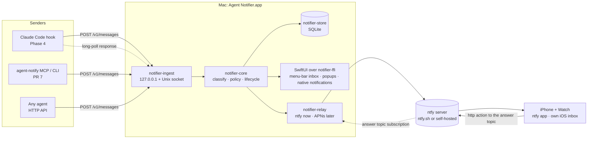
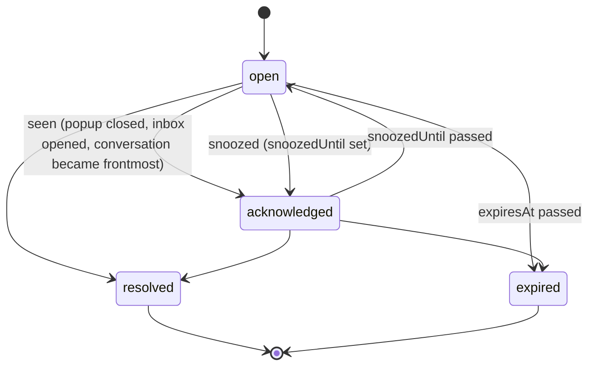
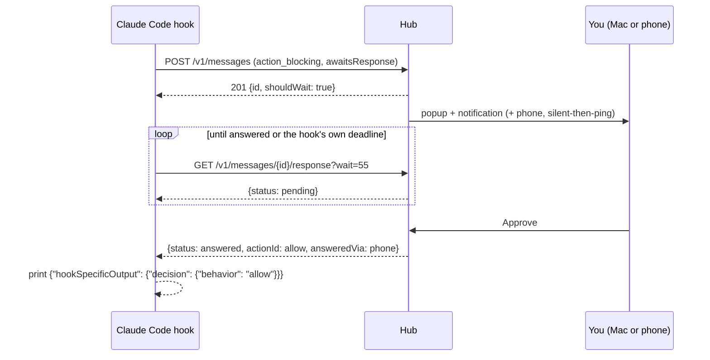

# Architecture

Agent Notifier receives messages from LLM agents, decides how loud each one should be, and delivers it to the Mac and the phone. The goal is a ping only for what needs you: a blocked session, a finished task when you are away, a question that can wait in an inbox. This document is the Phase 1 design. The decisions behind it are in [`adr/`](adr/), the wire format in [`schema/message-v1.json`](schema/message-v1.json), and the build order in [`implementation-plan.md`](implementation-plan.md).

Status tags: **Now** is built in Phase 3, **Planned** comes later, **Spike** must be verified before the PR that depends on it.

**Principle: no hosted infrastructure, bring your own keys.** Agent Notifier runs only on your own machines and talks only to services you choose, with credentials you create (an ntfy topic or account, a Pushover app token, an APNs key from your own Apple team, your own Tailscale network). The project runs no server, relay, account system or asset host for anyone, and no feature may depend on one. Every credential is entered in Settings and kept in the Keychain.

## 1. Classes

| Class | Meaning | Example |
| --- | --- | --- |
| `action_blocking` | The agent cannot continue until you answer | Claude Code permission prompt, MCP elicitation form |
| `action_nonblocking` | The agent wants an answer but keeps working | "Which name do you prefer? I used `Relay` for now" |
| `completion` | A task finished | Claude Code `Stop` with no background work left |
| `generic` | Everything else, kept for reference | Subagent finished, auth succeeded |

The sender may declare the class. Otherwise deterministic rules assign it, falling back to `generic`. No model is involved (§5).

## 2. System overview



## 3. Hub placement

ADR: [0001](adr/0001-hub-placement.md).

- **Mac (Now).** The Rust core runs in-process inside the SwiftUI menu-bar app, which registers itself as a login item (`SMAppService.mainApp`). One process owns the store, the ingest listener, the relay and the UI. The app talks to the core through UniFFI (`notifier-ffi`), not over HTTP.
- **Headless (Now, Linux-first).** The same crates build the `agent-notifierd` binary: ingest, store, policy and relay without a UI. It serves Linux, a Mac without the app, and the integration tests. On Linux it runs as a systemd user unit (Planned: the unit file and desktop notifications over D-Bus).
- **One hub per user.** Each hub takes an exclusive lock on `<state>/hub.lock` before it binds anything. A second hub (the app while `agent-notifierd` runs, or two app builds) exits with "another hub is running (pid …)" instead of splitting state. The app does not become a client of a running daemon; on the Mac the app is the hub.

State folder, following Vaultday's signing modes:

| Signing | State folder |
| --- | --- |
| Personal Team (App Group) | `~/Library/Group Containers/<TEAM>.com.eiluviann.agentnotifier` |
| Ad hoc / unsigned / `agent-notifierd` on macOS | `~/Library/Application Support/AgentNotifier` |
| `agent-notifierd` on Linux | `$XDG_STATE_HOME/agent-notifier` (default `~/.local/state/agent-notifier`) |

The folder holds `hub.db`, `hub.lock`, `rules.toml`, `config.toml` and the `API/` discovery folder (§8).

## 4. Crates and processes

| Crate | Status | Responsibility | Depends on |
| --- | --- | --- | --- |
| `notifier-core` | Now (PR 1) | Domain types (`Message`, `MessageClass`, `Source`, `Conversation`, `Action`, `LifecycleState`), classification, the policy engine, lifecycle transitions, action-token signing and verification (pure HMAC over bytes). Pure: no IO, no clock (time is passed in), no async | — |
| `notifier-store` | Now (PR 2a) | SQLite through `rusqlite` (bundled), migrations, retention sweep, the single-use action-token ledger | `notifier-core` |
| `notifier-relay` | Now (PR 5) | `Relay` trait, `ntfy` adapter (publish, update, clear, the answer-topic subscription), payload modes, icon attachments. Knows nothing of the hub | `notifier-core` |
| `notifier-hub` | Now (PR 2b) | The hub actor that serialises every state change, timers, dispatch to channels (the UI delegate and a `dyn Relay`), action-token minting against the ledger | `notifier-core`, `notifier-store`, `notifier-relay` (trait only) |
| `notifier-ingest` | Now (PR 2b; remote routes for the iOS app in PR 6) | HTTP/1.1 (`axum` on `tokio`): the local router on loopback and the Unix socket, and the optional remote router on the Tailscale address; auth, schema validation, rate limits, long-poll. Routes only translate HTTP to hub commands | `notifier-hub` |
| `agent-notifierd` | Now (PR 2b) | Binary: config, lock, logging, signal handling; wires hub, ingest and the configured relay | `notifier-ingest`, `notifier-hub`, `notifier-relay` |
| `notifier-ffi` | Now (PR 3) | UniFFI bindings for Swift. The only crate allowed `unsafe` (generated scaffolding); it has its own `[lints]` table | `notifier-hub`, `notifier-ingest`, `notifier-relay` |
| `notifier-node` | Planned | napi-rs bindings for the Linux Electron client | as `notifier-ffi` |

The graph is acyclic: core ← store, relay ← hub ← ingest ← binaries and bindings.

**Concurrency.** A single hub actor (one `tokio` task in `notifier-hub`) owns the in-memory view and is the only writer to the store. Ingest handlers, redeemed phone answers, the UI (through FFI) and the timers send it commands over an `mpsc` channel and await a reply. Long-polls wait on a per-message `tokio::sync::watch`. This makes "first answer wins" and supersede/resolve races impossible by construction rather than by locking.

**Platform sensing stays on the platform side.** Presence (frontmost app, idle seconds, screen locked, Focus) is read by Swift on the Mac and pushed into the core as `PresenceUpdate` commands; the daemon on Linux will read logind's idle hint (Planned). The core never calls platform APIs, so the policy engine stays a pure function with table tests.

## 5. Message lifecycle and classification

### 5.1 Ingest pipeline

```
POST /v1/messages
  → authenticate (bearer token)             401
  → rate limit (per source.agent)           429 + Retry-After
  → size limit (128 KiB body)               413
  → validate against message-v1.json        422 with the failing JSON pointer
  → idempotency (source.agent, idempotencyKey)  200 with the stored message
  → classify                                declared → user rules → built-in rules → generic
  → coalesce / dedupe / supersede / resolve (§7)
  → persist
  → policy engine → DeliveryPlan            (§6)
  → dispatch to channels; answer 201
```

Response body of `POST /v1/messages`:

```json
{ "id": "01JBM3Z8Q7Y4K2N6P0R5T9VWXA", "class": "action_blocking", "classSource": "declared", "state": "open", "shouldWait": true }
```

`id` is a ULID the hub assigns. It is the only message id in URLs and in `actionResponse.messageId`; the sender's `idempotencyKey` only deduplicates retries.

`shouldWait` tells a blocking sender whether long-polling is worthwhile. It is `false` when no channel can answer (every answer channel is muted, or the user is at the very app the agent runs in and the policy says not to interrupt there, §6.2), so a hook falls back to the agent's own prompt at once instead of holding it.

### 5.2 States



- `open`: delivered, needs attention; counts towards the menu-bar badge, may re-ping.
- `acknowledged`: you have seen it. No re-ping, no badge, still answerable. With `snoozedUntil` set it is hidden from the inbox's open list until then, and returns to `open` with one re-ping when the time passes (unless it was resolved meanwhile).
- `resolved` carries a reason: `answered` (an answer action was taken), `superseded` (a newer message took its slot, §7), `completed` (the conversation's completion closed it), `resolved_by_sender` (`resolves`, `POST /v1/messages/{id}/resolve`, or conversation progress), `dismissed` (you chose "Mark done" in the inbox without answering).
- `expired`: `expiresAt` passed while open or acknowledged.

Closing a popup or a notification only acknowledges; "Mark done" is the only user gesture that resolves without an answer.

**Answers and non-answers.** `approve`, `deny`, `choice` and `reply` are answers: the first one resolves the message as `answered` and wakes the waiter. `open` and `snooze` are non-answers: `open` acknowledges and brings the conversation forward, `snooze` acknowledges with `snoozedUntil = now + value` minutes (default 15). Neither is ever returned to a waiting sender.

**Live waiter.** A message has a live waiter while a long-poll for it is in flight or ended less than 10 s ago (the gap between two polls). `awaitsResponse` only declares the intent; it is the live waiter that counts everywhere below (answer buttons, supersede, completion). A sender that stops waiting (deadline, error, fallback to its own prompt) resolves its message with `POST /v1/messages/{id}/resolve`; if it dies without doing so, the waiter lapses after 10 s and the message becomes an ordinary item that completion or progress can close.

**What the long-poll returns** (`actionResponse.status`):

| Lifecycle | `status` |
| --- | --- |
| `open`, `acknowledged` (including snoozed) | `pending` |
| `resolved` / `answered` | `answered`, with `actionId`, `actionKind`, `value` |
| `resolved` / `superseded` | `superseded` |
| `resolved` / `completed`, `resolved_by_sender`, `dismissed` | `resolved` |
| `expired` | `expired` |

Default `expiresAt` when the sender gives none: `action_blocking` 24 h, `action_nonblocking` 7 days, `completion` 7 days, `generic` 24 h. `generic` messages are born `acknowledged`: they never badge.

**Retention.** Resolved and expired messages are deleted after 30 days. Since every class has a default expiry, nothing stays open forever unless a sender sets a far `expiresAt`. Configurable; the sweep runs at start and daily.

### 5.3 Classification

Order, first hit wins:

1. **Declared** `class` in the message.
2. **User rules** from `rules.toml`, in file order.
3. **Built-in rules** shipped with the app (the Claude Code mappings below), so the hook stays thin and you can see and override them.
4. **Fallback** `generic`.

A user rule may set `override = true` to beat a declared class too. This is the one escape hatch for a sender that over-declares (every message `action_blocking`); without it the declared class wins, as decided.

```toml
# rules.toml — matched top to bottom, first match wins.
[[rule]]
name = "Quiet the docs bot"
match = { source = "docs-bot" }
class = "generic"
override = true

[[rule]]
name = "Background agent finished"
match = { source = "claude-code", event = "claude-code.notification.agent_completed" }
class = "completion"

[[rule]]
name = "Mute auth success"
match = { event = "claude-code.notification.auth_success" }
mute = true          # stored as generic, never shown outside the inbox history
```

Match keys (all optional, all must hold): `source` (exact), `event` (glob), `title` (regex), `cwd` (glob), `metadata.<key>` (exact). A rule sets `class` and/or `mute`. Rules reload on file change; an invalid file keeps the last good rules and shows the parse error in Settings.

**Built-in Claude Code mapping** (the Phase 4 hook sends `event` and, where it is certain, `class`):

| Hook event | `event` | Class | Notes |
| --- | --- | --- | --- |
| `PermissionRequest` | `claude-code.permission_request` | `action_blocking` | Approve/deny/reply, `awaitsResponse`, `correlationKey = "permission:<agent_id or main>:<first 12 hex of SHA-256 of tool_name + tool_input>"` (the input has no `tool_use_id`), so parallel subagents' requests never supersede each other |
| `Notification` `permission_prompt` | `claude-code.notification.permission_prompt` | `action_blocking` | No waiter; while the conversation has a blocking item with a live waiter it folds into it as a repeat (§7.3). It stands alone for sandbox network prompts, which have no `PermissionRequest` |
| `Notification` `elicitation_dialog`, `elicitation_url_dialog` | `claude-code.notification.elicitation_*` | `action_blocking` | Answer in the session; `open` action only |
| `Notification` `idle_prompt` | `claude-code.notification.idle_prompt` | `action_nonblocking` | Fires 60 s after a response with no typing, i.e. after the `Stop` completion already pinged. Deviation from the plan (which listed idle as blocking): a second loud ping for the same turn is noise. `correlationKey = "idle"`; resolved by conversation progress |
| `Notification` `agent_needs_input` | `…agent_needs_input` | `action_blocking` | |
| `Notification` `agent_completed` | `…agent_completed` | `completion` | |
| `Notification` `quota_auto_resume_stale` | `…quota_auto_resume_stale` | `action_nonblocking` | Waits for Enter after a sleep |
| `Notification` `auth_success`, `elicitation_complete`, `elicitation_response`, `quota_auto_resume_fired`, `quota_auto_resume_disabled`, `plugin_notification` | `…<type>` | `generic` | |
| `Stop`, `background_tasks` empty | `claude-code.stop` | `completion` | Summary from `last_assistant_message` (first 400 chars) |
| `Stop`, `background_tasks` non-empty | `claude-code.stop.paused` | `generic` | The session waits on its own background work; not done yet |
| `StopFailure` | `claude-code.stop_failure` | `action_nonblocking` | The turn ended on an API error |
| `SubagentStop` | `claude-code.subagent_stop` | `generic` | |
| `SessionStart` | — | — | Registers or renames the conversation (`PUT /v1/conversations/{agent}/{id}`), sends no message |
| `UserPromptSubmit`, `PostToolUse`, `PostToolUseFailure` (all `async`) | — | — | `POST /v1/conversations/{agent}/{id}/progress`, sends no message (§7.6) |

## 6. Noise-policy engine

ADR: [0004](adr/0004-policy-engine.md).

### 6.1 Shape

```rust
fn decide(message: &Message, context: &PolicyContext, policy: &Policy) -> DeliveryPlan
```

- `PolicyContext`: presence (`away` = screen locked or idle ≥ `awayAfter`, frontmost bundle id), Focus on/off, quiet hours active, the conversation's open items, the clock.
- `Policy`: per-class settings from `config.toml`, defaults below.
- `DeliveryPlan`: `mac` (one of `persistent_popup`, `toast`, `banner`, `inbox_only`), `nativeNotification` (bool), `sound` (bool), `phone` (`now(priority)`, `silentThenPing { priority, after }`, `silent`, `none`) and `reping` (`after`, `max`).

Timers (re-ping, phone escalation, snooze, expiry) are scheduled by the hub actor; when one fires the actor re-runs `decide` with the current context, so a message answered in the meantime sends nothing. Every decision is stored in a `deliveries` table, which is what the inbox's "why did this ping me?" line reads.

### 6.2 Defaults

| Class | Mac | Phone |
| --- | --- | --- |
| `action_blocking` | Persistent rich popup until handled, plus a native notification and a sound. Re-ping every 5 min, at most 3 times, while `open` | Silent-then-ping (below), audible priority 5 |
| `action_nonblocking` | Native banner and inbox | Silent-then-ping, audible priority 3 |
| `completion` | Transient rich toast (6 s); suppressed when the conversation's app is frontmost; auto-acknowledged when you bring the conversation forward | Silent-then-ping, audible priority 3 |
| `generic` | Inbox only, silent | Never |

**Silent-then-ping** (the user's rule, 2026-10-23):

- **Mac in active use** (unlocked, input within `awayAfter`, default 5 min): the phone gets the notification at once but silently (ntfy priority 2: on iOS it lands in Notification Centre with no sound and no screen wake [ntfy-ios NotificationContent.swift:44-68]). If the message is still not addressed on any device 2 min later, it is republished at its audible priority and pings.
- **Mac away** (locked, or idle ≥ `awayAfter`): the phone pings at once at the audible priority.
- **Addressed** means acknowledged or resolved anywhere: answered on the Mac, the phone or in the session, the popup or notification closed, the conversation brought forward, or the message opened in the inbox.
- **Noise guard.** Escalations that fall within 60 s of each other share one sound; the rest update silently.

Every cell is configurable per class (and per source, Planned). With this rule a completion you ignore at the Mac also pings the phone after 2 min; turn the phone off for `completion` if that is too much.

### 6.3 Quiet hours and Focus

- **Quiet hours** (a weekly schedule, default off). Mac: no sounds; toasts and banners become inbox-only. Phone: everything stays silent (no escalation) except `action_blocking`, which breaks through by default (`quietHours.blockingBreaksThrough = true`).
- **Focus.** macOS already filters our native notifications by the active Focus, and a Personal Team build cannot claim the Time Sensitive entitlement to break through (§11). Our own popups and toasts are not subject to Focus, so the engine treats Focus like quiet hours for them: blocking popups still appear but silently; toasts become inbox-only.
- **How the hub learns Focus** (Spike S3, §11). Preferred, because it needs no setup beyond one permission: read the active Focus automatically from `~/Library/DoNotDisturb/DB/` (`Assertions.json`, `ModeConfigurations.json`), which needs a one-time Full Disk Access grant and is undocumented, so S3 checks it on macOS 26 and the app watches for format changes. Fallback when that fails: a Shortcuts personal automation "When <Focus> turns on/off" running `agent-notify focus on|off`, set up once per Focus. `INFocusStatusCenter` is not used: it needs the Communication Notifications entitlement, which free teams cannot claim.

### 6.4 Frontmost suppression

A completion is suppressed when `conversation.focus.bundleId` equals the frontmost app's bundle id. This is per app, not per tab: with two Claude Code sessions in one Ghostty window, finishing the background one is suppressed too. Tab-level matching (tty of the frontmost terminal tab) is Planned and needs Apple Events per terminal.

## 7. Coalescing, dedupe, supersede, resolve

All within one conversation (`source.agent` + `conversation.id`):

Rules are applied in this order by the hub actor, one message at a time, so none of them can interleave with an answer.

1. **Idempotency.** Same `source.agent` + `idempotencyKey` → return the stored message, change nothing.
2. **Supersede.** A message whose `correlationKey` matches an `open` or `acknowledged` message takes its slot: the old one resolves as `superseded`, the new one takes over its popup and native notification in place (same notification identifier, same ntfy sequence id). It does not re-ping unless its class is louder than the old one's. A live waiter of the old message gets `superseded`.
3. **Fold.** A message with no live waiter never displaces one that has a live waiter: if its correlation key matches such a message, or it is a blocking message while the conversation has a blocking item with a live waiter, it is not stored as a new item and only increases that item's repeat counter.
4. **Dedupe.** If the superseding message has the same class, title and summary as the old one and arrives within 10 s, it is dropped and only a repeat counter increases.
5. **Completion resolves blocking items.** A `completion` resolves the conversation's `open`/`acknowledged` `action_blocking` messages that have no live waiter, with reason `completed`. A message with a live waiter stays open (the agent cannot have finished while it waits). `action_nonblocking` messages are left alone: questions that can wait must survive the end of the turn.
6. **Progress resolves.** `POST /v1/conversations/{agent}/{id}/progress` (Claude Code: async `UserPromptSubmit`, `PostToolUse`, `PostToolUseFailure` hooks) resolves, as `resolved_by_sender`, the conversation's `idle` item and its blocking items without a live waiter: something happened, so whatever they asked for was answered in the session. This covers a permission answered or denied in the terminal, where `PostToolUse` alone would not fire.
7. **Explicit resolve.** `resolves: [keys]` on any message, or `POST /v1/messages/{id}/resolve`, closes those messages as `resolved_by_sender`.
8. **Popup coalescing.** The Mac shows at most one persistent popup per conversation (its newest blocking item) and stacks at most 3 conversations; more collapse into "+N waiting" which opens the inbox.

## 8. Ingest API and transport

ADR: [0002](adr/0002-ingest-transport.md).

**Listeners.**

- A Unix socket `<state>/API/hub.sock` (mode 0600, in a 0700 folder): the preferred transport for local clients, since only you can connect to it and nobody else can stand in for it.
- The same router on HTTP/1.1 `127.0.0.1:<port>` (random free port at start, never `0.0.0.0`) for clients that cannot use a socket.
- Remote listener for the own iOS app, off by default and only with Tailscale (§10, PR 6).

**Discovery** (Vaultday's pattern, hardened). `<state>/API/` (0700) holds `hub.sock`, `token` (0600, 256-bit random, base64url) and `port`. The hub removes `port` on quit. Clients (CLI, MCP server, hook) search the App Group container, then `~/Library/Application Support/AgentNotifier/API`, then `$XDG_STATE_HOME/agent-notifier/API` (`AGENT_NOTIFIER_API_DIR` overrides), use the socket when it exists, and fall back to TCP only after the hub proves itself: `POST /v1/hello {"nonce": "<random>"}` is the one unauthenticated route and answers `HMAC-SHA256(token, nonce)`. The client sends its bearer token only after checking that proof, so a process of another user squatting on a port left behind by a crash learns nothing.

**Endpoints** (all but `hello` require `Authorization: Bearer <token>`, the sender token). `{id}` is always the hub-assigned message id.

| Method and path | Purpose |
| --- | --- |
| `POST /v1/hello` | Challenge-response proof (above); returns hub version and schema versions |
| `POST /v1/messages` | Ingest one message (§5.1) |
| `GET /v1/messages/{id}/response?wait=<s>` | Long-poll for the answer; holds up to `wait` seconds (max 55), returns `actionResponse` (`pending` on timeout) |
| `POST /v1/messages/{id}/resolve` | Sender closes its own message (answered elsewhere, or it stopped waiting) |
| `PUT /v1/conversations/{agent}/{id}` | Register or rename a conversation (Claude Code `SessionStart`) |
| `POST /v1/conversations/{agent}/{id}/progress` | The conversation moved on (§7.6) |
| `POST /v1/presence/focus` | `{ "focused": true }` from the Shortcuts automation |

**No answer route for senders.** The sender token can post, wait and resolve, but cannot answer or list messages: an agent that can read `API/token` must not be able to approve its own permission prompt or read other sessions' messages. Answers come only from the Mac UI (in-process, through FFI) and from the phone with per-action tokens (§9.3). A local "answer from the CLI" is Planned behind a separate answer credential kept in the Keychain with user presence (Touch ID), which an agent cannot read silently.

**`Host` check.** On TCP, `Host` must be `127.0.0.1:<port>` or `localhost:<port>`; on the Unix socket it is not checked (clients send `Host: localhost` or nothing).

**Rate limits.** Token bucket per `source.agent`: burst 30, refill 1/s; per-conversation burst 10. Over the limit → 429 with `Retry-After`. Body limit 128 KiB.

**Versioning.** `/v1/` in the path and `"version": 1` in the body. Additive optional fields stay in v1; anything else is v2 on a new path, served alongside v1 for at least one release.

## 9. Action round-trip

### 9.1 Local



- **First answer wins.** The hub actor accepts the first answer and resolves the message; later answers (the other device, a re-tap) get 409 and the UI shows "Already answered on <channel>".
- **Answer buttons need a live waiter** (§5.2). Without one, approve/deny/reply/choice are hidden (and disappear from an open popup when the waiter lapses) and only open, snooze and Mark done remain, so a button never pretends to do something.
- **The hook cleans up.** Whenever it stops waiting without an answer it calls `POST /v1/messages/{id}/resolve` before printing nothing, so the popup closes as the agent's own prompt takes over.
- **Mapping for Claude Code `PermissionRequest`** (Phase 4): `approve` → `{"behavior": "allow"}`; `deny` → `{"behavior": "deny", "message": "Denied from Agent Notifier"}`; `reply` → `deny` with your text as `message`, which tells Claude what to do instead.
- **Timeouts.** Command hooks default to a 600 s timeout and are cancelled at it, output discarded; no maximum is documented [CC-hooks › Common fields, Timeouts]. The hook sets its own deadline below its configured `timeout` and exits with no output, which leaves the permission flow unchanged [CC-hooks › PermissionRequest decision control].
- **Fallback.** No answer by the deadline, `shouldWait: false`, hub unreachable, or any error → the hook prints nothing and Claude Code shows its own prompt. The notifier never decides on its own.

### 9.2 Open

`open` brings the conversation forward, trying in order: `focus.url` (only schemes on the allowlist: `claude-cli`, `claude`, `vscode`, `cursor`, `https`), then the terminal tab (Planned: Apple Events to Terminal.app and iTerm2 by tty), then activating `focus.bundleId`. Claude Code has no URL that opens a specific session: `claude-cli://open` starts a new terminal session with `cwd`/`repo`/`q` [CC-deeplinks], and Claude Desktop documents only `claude://code/new` [CC-desktop › Open an SSH session from a link]. So a Desktop-hosted session is opened by activating `com.anthropic.claudefordesktop`, and a terminal session by activating its terminal app.

### 9.3 Phone

- The ntfy notification carries up to 3 buttons. On iOS only `view` and `http` actions exist [ntfy-ios Actions.swift]; `http` is sent by the phone itself (`URLSession`) [ntfy-ios ActionExecutor.swift].
- **Answers travel back through ntfy; nothing reaches into the Mac.** Each `http` button posts to an **answer topic** on the same ntfy server, `POST https://ntfy.sh/<answerTopic>`, with the action token as the body. The hub keeps an outbound streaming subscription to that topic (`GET /<answerTopic>/json`, reconnecting with backoff) and redeems tokens as they arrive. No port is opened, no VPN is needed, and it works wherever the phone has internet. The answer topic is a second random 32-character secret; on a server with ACLs the button carries a write-only token for it in its `headers`.
- **Action tokens.** `base64url(payload) "." base64url(HMAC-SHA256(key, payload))`, payload = message id, action id, nonce, expiry. The key is 256-bit, per hub, in the Keychain (Mac) or a 0600 file (daemon). Expiry = min(message `expiresAt`, 30 min); the nonce is recorded on first use, so a replay is ignored and logged. Constant-time comparison. Tokens are not secret from the ntfy server (they sit in the published button), which is why they are single-use, short-lived and bound to one message and action.
- **Self-answers are refused.** Tokens are minted only by the hub and published only to the notification topic; both topic names and the ntfy credentials live in the Keychain, not in `config.toml`. An agent on the Mac can neither read a token nor forge one.
- **Which actions go to the phone.** In the default `summary` payload mode the notification says what is needed (§10), so `approve`, `deny` (when not `destructive`), `choice` (at most 2) and `snooze` go out as `http` buttons, at most 3 in total. In `minimal` mode, and for `sensitive` messages, there are no answer buttons: you cannot read what you would approve. Never `reply` (no text input in ntfy), never `destructive` actions.
- **Feedback.** ntfy on iOS gives no result for an `http` action and opens the ntfy app [ntfy-ios NotificationContent.swift:166]. Once the token is redeemed, the hub republishes the same sequence id with "Approved from phone" (Spike S2: whether the iOS app honours updates is unverified).

## 10. Phone relay

ADR: [0005](adr/0005-ios-transport.md).

**Relay trait** (`notifier-relay`): `publish(PhoneNotification) -> RelayReceipt`, `update(receipt, PhoneNotification)`, `clear(receipt)`, `answers() -> Stream<ActionToken>`. Adapters, each configured with your own credentials: `ntfy` (Now; ntfy.sh by default, self-hosted supported; optional ntfy account token), `pushover` (Planned option, ADR 0005; your own application token and user key), `apns` (Planned, §13; your own APNs key), `noop` (tests). Publish failures retry 3 times with backoff (1 s, 5 s, 30 s) and then show "Phone delivery failing" in the menu bar.

**What a notification shows** (the user's spec, 2026-10-23; the same on the Mac's native notifications and the phone):

| Message | Title |
| --- | --- |
| `action_blocking` with an `approve` or `deny` action | URGENT: Action required |
| `action_blocking` otherwise (question, elicitation, needs input) | URGENT: Your input is needed |
| `action_nonblocking` with an `approve` or `deny` action | Action required |
| `action_nonblocking` otherwise | Your input is needed |
| `completion`, `scope: task` (default) | Task complete |
| `completion`, `scope: goal` | Goal complete |

- **Description:** the message `summary`: what is needed, or what was done. Falls back to the message `title` when there is no summary. The message title and the project/conversation name appear as the Mac notification's subtitle and in popups; on the phone they are left out to keep it short.
- **Icon:** the project icon by default, else the agent icon. The project icon is resolved by the hub from `conversation.cwd` (a per-project override in Settings, then `.agent-notifier/icon.png`, then common icon files the PR 4 work defines) and cached as a 256-px PNG; agent icons are bundled (Claude Code, Codex, a generic one). On the Mac popups and toasts show it, and native notifications carry it as an attachment thumbnail (the notification's app icon is always Agent Notifier's). On the phone the ntfy iOS app ignores ntfy's `icon` field but shows an image attachment as the thumbnail [ntfy-ios NotificationContent.swift:79-123]: both agent and project icons are uploaded with the message from the Mac (ntfy.sh keeps attachments 3 h), so nothing depends on a hosted asset, and the ntfy server sees only the icon itself.

**ntfy mapping.**

| | ntfy field |
| --- | --- |
| Topics | Notification topic and answer topic: random 32-character base64url strings, generated at setup, kept in the Keychain; on servers without ACLs the topic acts as the password [ntfy-faq] |
| Auth | `Authorization: Bearer tk_…` when the server has ACLs [ntfy-publish › Access tokens]; the token lives in the Keychain |
| Priority | Silent 2 (iOS: passive). Audible: `action_blocking` 5, others 3. On iOS 5 maps to Time Sensitive (Critical if you enabled critical alerts in the ntfy app), 4 to Time Sensitive, 3 to Active, 1–2 to Passive [ntfy-ios NotificationContent.swift:44-68] |
| Escalation | Republish the same sequence id at the audible priority (Spike S2: does iOS re-alert on an update? If not, clear the silent one and publish a new message) |
| Sequence id | The hub message id of the slot (kept across supersedes), so supersede updates and resolve clears the phone notification [ntfy-publish › Updating notifications] |
| Markdown | Off: the iOS app has no markdown rendering in its source |

**Payload modes** (Settings › Phone):

- `summary` (default, the user's choice): title phrase, summary, icon.
- `minimal`: title phrase only, no answer buttons. For people who route through ntfy.sh and want it to learn nothing but "something happened".
- `sensitive: true` on a message forces `minimal`, whatever the mode. `body` and `cwd` never go to the phone relay.

**ntfy.sh or self-hosted.** Both are supported; ntfy.sh is the default because it needs no setup. With ntfy.sh, the summary and the action tokens pass through a third party (no end-to-end encryption, issue #69 open [ntfy-gh-69]). A self-hosted server keeps the content on your machine: instant iOS delivery then needs `upstream-base-url: https://ntfy.sh`, and only a poll request (message id and the SHA-256 of the topic URL) goes upstream; the phone fetches the content from your server, which it must be able to reach [ntfy-config › iOS instant notifications].

**Limits** [ntfy-publish › Limitations]: message 4,096 bytes, title 1 KB; ntfy.sh allows 250 messages a day per visitor and a burst of 60 requests. Silent-then-ping can publish a message twice; a busy day stays well below the cap.

**Watch.** The Watch mirrors the iPhone's ntfy notifications (standard iOS behaviour for apps without a Watch app). Whether the `http` buttons work from the Watch is Spike S2.

**Own iOS app** (PR 6, optional). An inbox and detail viewer for full content and text replies. Unlike answers, it needs a network path from the phone to the Mac: Tailscale (a free VPN app that puts the phone and the Mac on one private network so they can reach each other from anywhere, without opening ports), with a device token issued by pairing (QR code in Settings) and HTTPS with the Tailscale MagicDNS certificate, which avoids App Transport Security exceptions [ATS-local]. It cannot receive push without APNs, so ntfy still delivers the ping. Nothing else in the design needs Tailscale.

## 11. Platform constraints and verified answers

Answers to the Phase 1 open questions, with sources (§13).

### macOS Focus

- `INFocusStatusCenter` exists on macOS 12+ and reports only `isFocused: Bool?`, no Focus name; it is true only when a Focus is on and the app is not on that Focus's allowed list, and `nil` without authorisation [Apple-focus-doc].
- It needs `NSFocusStatusUsageDescription` and the Communication Notifications entitlement [Apple-forum-685744]. Communication Notifications is not available to free (Personal Team) accounts on macOS or iOS [Apple-caps-macos, Apple-caps-ios]. **Not feasible on a Personal Team.** Claiming it without a profile gets the app killed at launch (restricted entitlement) [Vaultday signing.md › TN3125].
- Time Sensitive Notifications is also paid-only [Apple-caps-macos], so our native notifications cannot break through Focus.
- Chosen (the user prefers no setup): read the active Focus from `~/Library/DoNotDisturb/DB/` behind a one-time Full Disk Access grant, undocumented and unverified on current macOS [focus-cli] (Spike S3). Fallback: a Shortcuts Focus automation → `agent-notify focus on|off` (S3 also confirms macOS 26 Shortcuts offers the Focus trigger on the Mac).
- Idle seconds (`CGEventSourceSecondsSinceLastEventType`), screen lock (the `com.apple.screenIsLocked`/`screenIsUnlocked` distributed notifications, undocumented but long-standing) and the frontmost app (`NSWorkspace`) need no entitlement (unverified by a source; checked in PR 3).

### ntfy

- Up to 3 action buttons per notification [ntfy-publish › Action buttons]; the iOS app takes at most 4 and only `view` and `http` [ntfy-ios].
- `http` defaults to POST and supports `method`, `headers`, `body`, `clear` (clear only on success) [ntfy-publish › Send HTTP request]; on iOS the phone sends it directly, with no visible result, `clear` not implemented, and the tap opens the app [ntfy-ios ActionExecutor.swift, NotificationContent.swift].
- Priorities 1–5 (min, low, default, high, max/urgent); iOS mapping in §10, where 1–2 are passive (silent).
- The iOS app ignores the `icon` field but shows image attachments as the notification thumbnail [ntfy-ios NotificationContent.swift:79-123].
- ntfy.sh: anonymous use works with an unguessable topic; accounts and access tokens (`tk_…`) for ACLs; paid tiers raise limits and allow reserved topics [ntfy-publish, ntfy-config]. Self-hosted: `auth-file` + `auth-default-access: deny-all`, per-user topic ACLs and tokens [ntfy-config].
- iOS instant delivery only through ntfy.sh's APNs/Firebase relay; self-hosted needs `upstream-base-url` [ntfy-config, ntfy-known-issues].
- **Risk:** the ntfy FAQ calls the iOS app bare-bones and somewhat buggy with development paused, and known issues include notifications silently stopping until the subscription is re-added [ntfy-faq, ntfy-known-issues]. No end-to-end encryption (issue #69 open) [ntfy-gh-69]. See ADR 0005 for the contingency.

### Claude Code hooks

- **Common input**: `session_id`, `transcript_path`, `cwd`, `permission_mode`, `hook_event_name` [CC-hooks › Common input fields]. No field names the surface (CLI, Desktop, IDE) or the terminal. Observed, undocumented: `CLAUDE_CODE_ENTRYPOINT=claude-desktop` and `__CFBundleIdentifier=com.anthropic.claudefordesktop` in the environment of a Desktop session; terminals set `__CFBundleIdentifier` and `TERM_PROGRAM`. The hook reads these best-effort for `focus.bundleId`.
- **`Notification`**: input adds `message`, optional `title`, `notification_type`; cannot block or return anything. Types: `permission_prompt` (prompt waited ~6 s; in Desktop/VS Code ~6 s without the typing deferral), `idle_prompt` (~60 s after a response, no typing, no background agent), `auth_success`, `elicitation_dialog`, `elicitation_url_dialog`, `elicitation_complete`, `elicitation_response`, `agent_needs_input`, `agent_completed`, `quota_auto_resume_fired`, `quota_auto_resume_stale`, `quota_auto_resume_disabled`, `plugin_notification`. The hook runs even with desktop notifications turned off [CC-hooks › Notification].
- **`Stop`**: adds `stop_hook_active`, `last_assistant_message`, `background_tasks`, `session_crons`; not fired on user interrupt; API errors fire `StopFailure` instead [CC-hooks › Stop].
- **`SubagentStop`**: adds `agent_id`, `agent_type`, `agent_transcript_path`, `last_assistant_message`, `stop_hook_active` [CC-hooks › SubagentStop].
- **`PermissionRequest`**: input `tool_name`, `tool_input`, optional `permission_suggestions` (and `mcp_server` for MCP tools); runs only when Claude Code is about to ask. It **can** return `{"hookSpecificOutput": {"hookEventName": "PermissionRequest", "decision": {"behavior": "allow"|"deny", …}}}` with `updatedInput`/`updatedPermissions` (allow) or `message`/`interrupt` (deny); allow never overrides a deny rule. No decision leaves the flow unchanged, except in sessions that cannot prompt (background subagents, `-p`), where no decision means deny. In Desktop and VS Code (the Agent SDK `canUseTool` host) the hook runs alongside the dialog and whichever decides first applies [CC-hooks › PermissionRequest].
  - **Spike S1 (Phase 4):** whether the **terminal** CLI shows its prompt while a `PermissionRequest` hook is still running is not documented. If it waits for the hook, a long-polling hook would hide the prompt from you at the terminal; `shouldWait` and a short deadline when you are present at that terminal are the mitigation.
- **`SessionStart`**: adds `source` (`startup`, `resume`, `clear`, `compact`, `fork`), optional `model`, `agent_type`, and `session_title` (custom titles only; generated titles never appear) [CC-hooks › SessionStart].
- **Timeouts**: default 600 s for command hooks, cancelled at timeout with output discarded; no documented maximum. Matching hooks run in parallel; `async: true` runs a command hook in the background without a decision [CC-hooks › Common fields, Timeouts, Run hooks in the background].
- **Deep links**: `claude-cli://open?cwd=…&repo=…&q=…` opens a new terminal session; no session id parameter. Claude Desktop: `claude://code/new` only. `claude --resume <session-id>` resumes from a terminal [CC-deeplinks, CC-desktop, CC-sessions]. No way to focus an existing session by link.
- **Plugins** can bundle hooks and MCP servers; plugin hooks merge with (add to) user and project hooks, never replace them [CC-hooks, CC-plugins]. `claude -p --bare` skips hooks entirely [CC-headless].

### Personal Team

- Free accounts can use App Groups and Keychain Sharing on macOS and iOS (plus Background Modes on iOS); not Push Notifications, iCloud/CloudKit, Time Sensitive, Communication Notifications, Associated Domains, Network Extensions [Apple-caps-macos, Apple-caps-ios].
- iOS: profiles and App IDs expire after 7 days (rebuild and reinstall weekly), at most 10 App IDs, 3 devices and 3 apps per device [Apple-memberships]. Vaultday's iOS app (if any) counts against the same 3.
- macOS: an app without restricted entitlements needs no provisioning profile, so only the certificate (about a year) expires [Apple-forum-705932]; with a team-prefixed App Group (unrestricted on macOS) the Mac app does not need weekly rebuilds. If it ever claims `keychain-access-groups`, the 7-day profile applies as in Vaultday. Local `UNUserNotificationCenter` notifications with action categories and `SMAppService` login items need no paid capability (unverified by a source; checked in PR 3/4).
- Tailscale traffic runs over a VPN interface, which is not "local network" for iOS Local Network Privacy, so no `NSLocalNetworkUsageDescription` prompt is expected [TN3179].

## 12. Security model

**Trust boundary: your macOS user account, minus the agents.** Any process running as you can already read your files and drive your apps, so the notifier does not try to defend its data against them. The one exception is the decision it gates: the agents that send messages run as you too, and none of them may answer its own question. Hence the split between the sender token (readable by any of your processes) and the answer paths (in-process UI, phone with per-action tokens, Planned Keychain-held answer credential).

| Threat | Mitigation |
| --- | --- |
| An agent approves its own permission prompt | The sender token cannot answer or list (§8); action tokens are minted only by the hub and published only to a topic whose name, like the ntfy credentials, lives in the Keychain; Claude Code itself still evaluates deny rules after an allow [CC-hooks › PermissionRequest decision control] |
| Another user or a remote host posts messages | Ingest binds loopback only; Unix socket 0600 in a 0700 folder, preferred; bearer token 0600 (or the App Group container); TCP clients send the token only after the hub's challenge-response proof (§8) |
| A web page in your browser posts to the loopback port (DNS rebinding, CSRF) | Bearer token required on every route but `hello`; `Host` must be `127.0.0.1:<port>` or `localhost:<port>` on TCP; no CORS headers, so browsers cannot read responses; `Content-Type: application/json` only |
| A buggy agent floods you | Rate limits per agent and per conversation (§8); supersede and dedupe (§7); per-source mute rules |
| Malicious content in a message | Markdown rendered without HTML, without remote images; links show their URL and need a click; `focus.url` limited to an allowlist of schemes; titles and summaries are plain text |
| ntfy.sh (third party) reads notifications | By the user's choice it sees the title phrase, the summary, the icon and the action tokens, never `body` or `cwd`; `minimal` mode and `sensitive` messages reduce that to the phrase; a self-hosted server keeps content local; topics are random 32-character secrets; access token when ACLs exist; Pushover (end-to-end encrypted) is the alternative in ADR 0005 |
| Someone replays or forges a phone action | HMAC-signed, single-use, 30-min tokens bound to message and action, so a token seen on the ntfy server is worth at most the one answer it encodes, and only before you give yours; no secrets in URLs; destructive actions never one-tap; no inbound port on the Mac |
| A stolen phone answers | Rotate the topics in Settings (the old phone stops receiving and its buttons stop working); answers are logged with channel |
| Secrets leak into logs or the store | Logs never contain bodies, tokens or `tool_input`; `metadata` is documented as non-secret; the token file is regenerated on demand from Settings |

## 13. Future paths

- **Linux (Planned).** `agent-notifierd` as a systemd user unit; desktop notifications over `org.freedesktop.Notifications` with actions; presence from logind's `IdleHint`; an Electron tray client on `notifier-node` (napi-rs) for the inbox and popups. Discovery uses `$XDG_STATE_HOME`. The ntfy relay works unchanged.
- **APNs (Planned, needs the paid membership).** An `apns` adapter behind the same `Relay` trait sends from the Mac straight to Apple's push service (`api.push.apple.com`, token-based auth) with your own APNs key (`.p8`) from your paid team, to your own build of the iOS app signed by the same team: Time Sensitive interruption level, native action categories (approve/deny/reply on the lock screen and the Watch). Answers come back through the iOS app over your own network path (Tailscale) or, without one, through the ntfy answer topic. No relay server. Because an APNs key only reaches apps signed by its own team, this path is for people who build and sign the app themselves; a shared store build would need a central push relay, which this project will not run. The paid team also unlocks `INFocusStatusCenter` and Time Sensitive on the Mac.
- **Windows (Planned, unscheduled).** Same as Linux with toast notifications.
- **Other agents.** Any agent can POST the v1 schema; the CLI and MCP server (PR 7) cover agents that can run a command or an MCP tool.

## 14. Sources

- [CC-hooks] Claude Code, Hooks reference: https://code.claude.com/docs/en/hooks (sections named inline; read 2026-10-23)
- [CC-deeplinks] Claude Code, Launch sessions from links: https://code.claude.com/docs/en/deep-links
- [CC-desktop] Claude Code, Desktop › Open an SSH session from a link: https://code.claude.com/docs/en/desktop
- [CC-sessions] Claude Code, Sessions: https://code.claude.com/docs/en/sessions
- [CC-headless] Claude Code, Headless mode: https://code.claude.com/docs/en/headless
- [CC-plugins] Claude Code, Plugins: https://code.claude.com/docs/en/plugins/overview
- [ntfy-publish] https://docs.ntfy.sh/publish/
- [ntfy-config] https://docs.ntfy.sh/config/ (iOS instant notifications, auth)
- [ntfy-faq] https://docs.ntfy.sh/faq/
- [ntfy-known-issues] https://docs.ntfy.sh/known-issues/
- [ntfy-ios] https://github.com/binwiederhier/ntfy-ios (`ntfy/Utils/Actions.swift`, `ActionExecutor.swift`, `NotificationContent.swift`; last commit 2026-06-26)
- [ntfy-gh-69] https://github.com/binwiederhier/ntfy/issues/69
- [Apple-focus-doc] Handling communication notifications and Focus status updates: https://developer.apple.com/documentation/usernotifications/handling-communication-notifications-and-focus-status-updates; INFocusStatusCenter: https://developer.apple.com/documentation/intents/infocusstatuscenter
- [Apple-forum-685744] https://developer.apple.com/forums/thread/685744
- [Apple-caps-macos] https://developer.apple.com/help/account/reference/supported-capabilities-macos
- [Apple-caps-ios] https://developer.apple.com/help/account/reference/supported-capabilities-ios
- [Apple-memberships] https://developer.apple.com/support/compare-memberships/
- [Apple-forum-705932] https://developer.apple.com/forums/thread/705932
- [TN3179] Understanding local network privacy: https://developer.apple.com/documentation/technotes/tn3179-understanding-local-network-privacy
- [ATS-local] NSAllowsLocalNetworking: https://developer.apple.com/documentation/bundleresources/information-property-list/nsapptransportsecurity/nsallowslocalnetworking
- [focus-cli] https://pkg.go.dev/github.com/legnoh/focus-cli
- [Vaultday signing.md] the signing notes of the author's Vaultday project (private), which cite TN3125 and the capabilities table above
